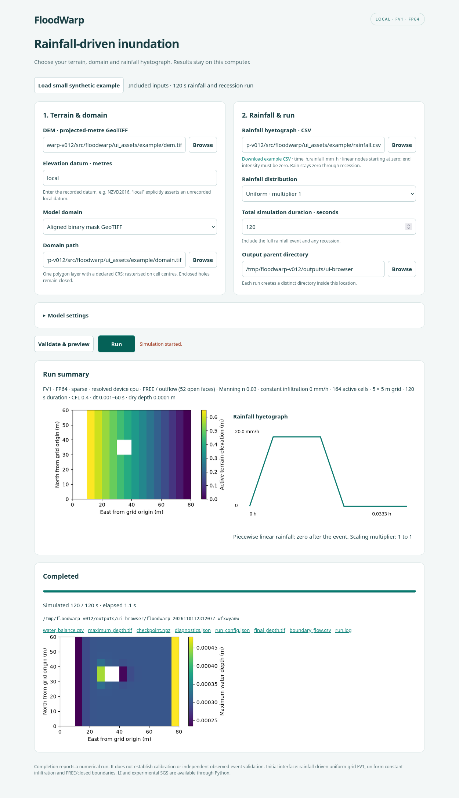
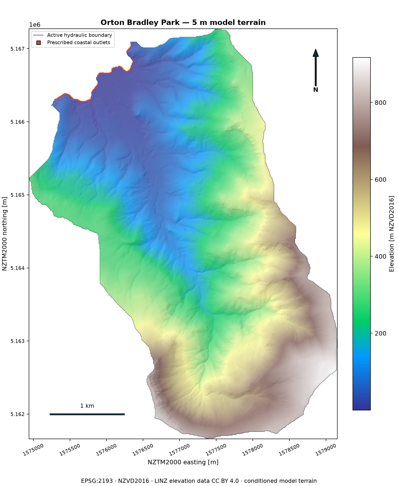
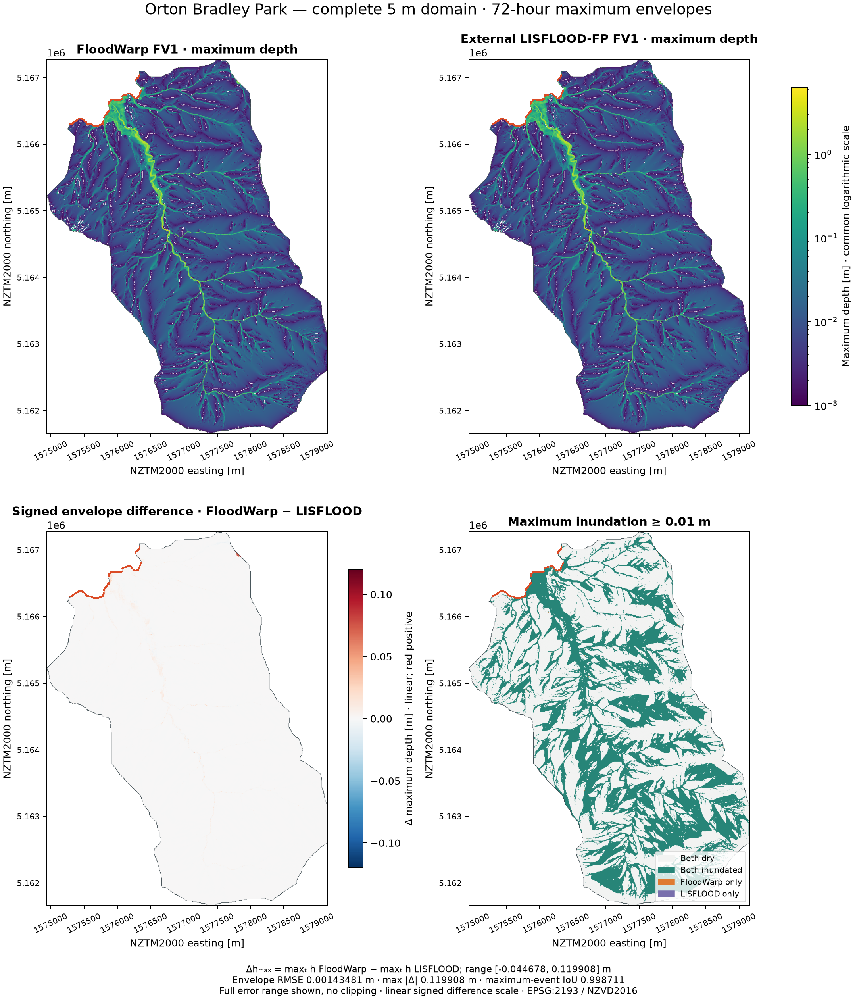
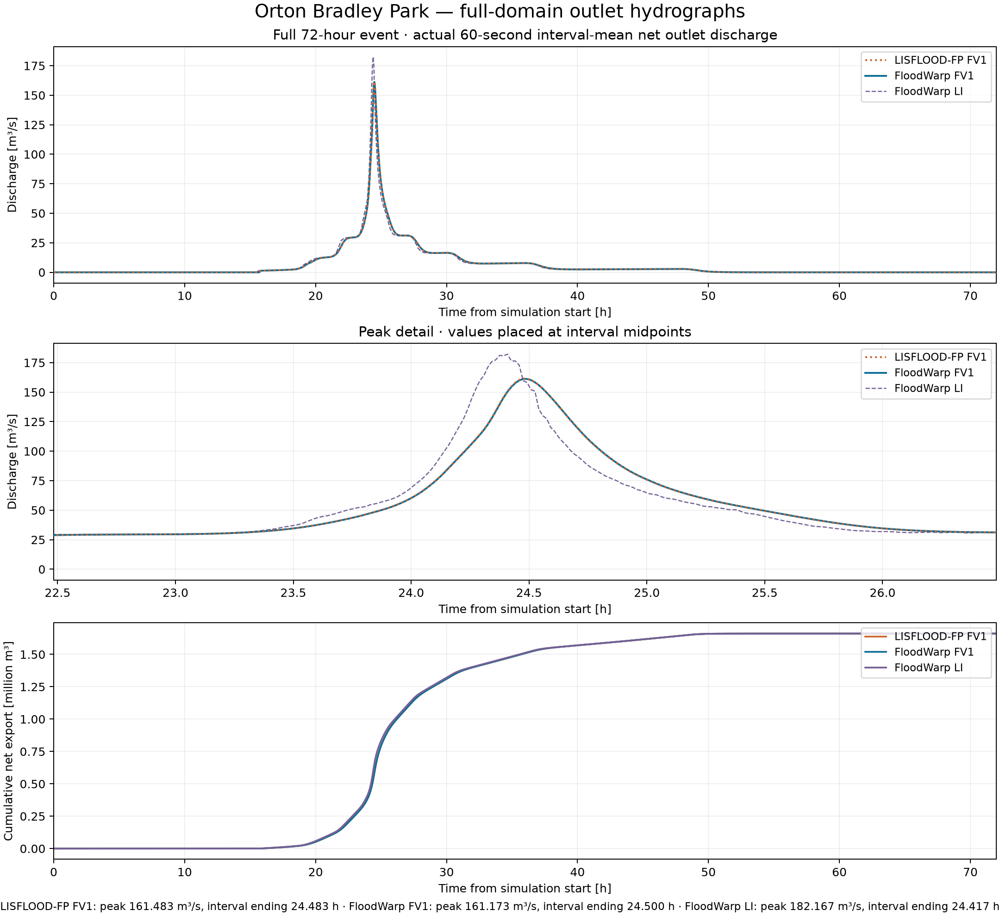

# FloodWarp

FloodWarp simulates rainfall-driven surface flooding on CPU and NVIDIA CUDA.
The primary solver is FP64, uniform-grid FV1, an independent first-order
finite-volume implementation of the full shallow-water equations. Copyright
**Patrick Durney and Lincoln Agritech Ltd**. Software is
[AGPL-3.0-only](LICENSE); attributed elevation data retain CC BY 4.0.

| Method | Interface | Status and scope |
|---|---|---|
| FV1 | Local UI, Python factories, native class | Ordinary high-level default; exact sparse scheduling with dense storage; explicit dense override |
| LI | Explicit `solver_method="li"`, native class | Reduced-complexity local-inertial alternative; ordinary LI physical profile retained |
| Traditional SGS | Explicit LI Python configuration | Experimental common-stage subgrid geometry |
| Enhanced SGS | Explicit LI Python configuration | Experimental component-aware subgrid geometry |

Static-mesh FV1, dynamic AMR, wavelets, mixed-precision FV1, surrogate and
coupled-model research are excluded. Numerical agreement with an independent
solver does not establish observed-event validation or grid convergence.
Read the [responsible-use guidance](DISCLAIMER.md) when interpreting results.

## Installation and tested environment

Use **Python 3.14** in a fresh virtual environment. From the release checkout:

```bash
python -m venv .venv
source .venv/bin/activate
python -m pip install '.[ui]'
python -m pip check
```

For the supplied wheel, use `python -m pip install './floodwarp-0.1.2-py3-none-any.whl[ui]'`.
`python -m pip install .` installs just the numerical core. UI and raster/plot
packages are optional; ordinary solver imports do not require them. Numerical
pins remain NumPy 2.3.5, SciPy 1.16.3, Numba 0.67.0 and Warp 1.17.0.

Release testing covers Linux x86-64, Python 3.14.7, CPU and NVIDIA RTX 4070 Ti
SUPER. Other platforms require compatible Python 3.14 dependencies and local
validation. CUDA wheel use needs a compatible NVIDIA driver, not a separate
system CUDA toolkit. No prepared-model installation or external solver
executable is required. See [development guidance](docs/DEVELOPMENT.md).

## Launch the local interface

```bash
python -m floodwarp.ui
```

Open **http://127.0.0.1:8765**. Choose local files using Browse or enter their
paths; select an existing output parent and press **Validate & preview**, then
**Run**. Execution happens in a worker process. The page shows simulated and
wall time, status, logs, outputs and a maximum-depth preview. Refreshing does
not start another run.



The initial UI supports rainfall-driven FV1, uniform Manning roughness,
uniform constant infiltration in mm/h, CPU/automatic/specific CUDA devices,
and explicit FREE/outflow or Closed boundaries. FREE opens exterior-connected
domain interfaces; enclosed NoData holes remain closed. No coastal stages are
inferred. Sparse execution and CUDA-graph defaults remain unchanged.
[Detailed UI guide](docs/UI.md) explains inputs, boundaries and replay.

## Prepare inputs

- **DEM:** single-band, north-up projected-metre GeoTIFF; metre elevations and
  an explicit vertical datum. Elevations and resolution are preserved.
- **Domain:** all valid DEM cells, an aligned binary GeoTIFF, or valid polygons
  in one GeoPackage layer / declared-CRS GeoJSON. Polygons are transformed to
  DEM CRS and rasterised on its grid with `all_touched=False`. Intersect with
  valid DEM cells; empty domains fail. No terrain resampling or conditioning.
- **Rainfall hyetograph:** CSV headed `time_h,rainfall_mm_h`, at least two finite
  increasing nodes starting at zero, non-negative intensities and a final zero
  node. Linear interpolation; zero rainfall throughout any recession. Duration
  must cover the entire event. River discharge is not rainfall.
- **Distribution:** uniform multiplier 1 or an aligned dimensionless spatial
  scaling GeoTIFF. Local rainfall = hyetograph × multiplier. Finite non-negative
  active-cell values are required; zero is valid. No normalisation.

Raster fields must match DEM CRS, transform, shape and cell size and cover the
active domain. The [input guide](docs/INPUTS.md) covers row orientation, datum,
forcing, infiltration, boundaries and checkpoint identity.

## Run a small example and find results

In the UI, click **Load small synthetic example**, choose an output parent and
Run. The installed distribution includes a tiny DEM, binary domain, polygon,
scaling map and rainfall CSV. Its 120 s run includes a 72 s event and recession.
`python -m floodwarp.ui_example` copies those inputs to `floodwarp-example` for
editing. The UI creates a distinct `floodwarp-<timestamp>-<suffix>` directory.

Results include `maximum_depth.tif`, `final_depth.tif`, `water_balance.csv`,
`boundary_flow.csv`, `checkpoint.npz`, detailed logs and `run_config.json` with
input checksums and resolved numerical/device/source provenance. GeoTIFFs
preserve the DEM grid, CRS, mask and metre units. Boundary-flow time series are
**aggregate boundary flows**, not a selected river outlet. Maximum-event maps
are distinct from simultaneous final depth. Checkpoints are saved after each
completed diagnostic interval; full depth snapshots are not accumulated.

From a source checkout, `python -m examples.run_synthetic` runs explicit FV1
and LI controls. `python -m examples.run_purau` is the historical **200 m Orton
Bradley installation crop**; the name does not identify the actual Purau
catchment. [run_direct.py](examples/run_direct.py) is the editable own-DEM FV1
example. These examples write to `outputs/` and reach their exact final time.

## Equivalent Python API

The same reusable runner works without the browser:

```python
from pathlib import Path
from floodwarp.ui_runner import RunConfig, create_run_directory, execute_run


if __name__ == "__main__":
    output_parent = Path("outputs")  # Create or choose an existing directory.
    config = RunConfig(
        dem="floodwarp-example/dem.tif",
        domain_mode="raster", domain="floodwarp-example/domain.tif",
        rainfall_csv="floodwarp-example/rainfall.csv",
        output_parent=str(output_parent), vertical_datum="local",
        duration_s=120., interval_s=30., device="cpu", boundary="free",
    )
    output_parent.mkdir(parents=True, exist_ok=True)
    output = create_run_directory(parent=output_parent)
    execute_run(config=config, output=output)
```

`prepare_run` and `create_run_model` expose the resolved inputs and ordinary
`floodwarp.model` object. `create_model(terrain=terrain)` and
`create_overland_solver(...)` now default to FV1 deliberately in v0.1.2.
Pass `solver_method="li"` for LI, or use native `LocalInertialSolver`.
FV1 defaults to exact sparse execution; `execution_mode="dense"` retains the
reference. Existing checkpoints retain their formulation identity; incompatible
loads fail. SGS callers must explicitly select LI.

## Validation and performance evidence

The [current evidence index](validation/README.md) separates analytical controls,
independent FV1 comparisons, sparse/dense parity, restart tests and scientific
limitations. [v0.1.2 verification](validation/release_v0.1.2/REPORT.md) distinguishes
new interface/default/packaging checks from retained numerical evidence.
Run source regressions with `python -m pip install '.[test,ui]'` then
`python -m pytest -q`. Opt-in FV1 CUDA tests use the retained
`OVERLANDER_TEST_FULL_SWE_CUDA=1` flag.

The release baseline already contained the verified modified sparse FV1 path:
**1512.372 s** hydraulic time versus **1641.957 s** released sparse and
**1906.106 s** dense in the matched 72-hour Orton Bradley event, with all 72
hourly state checks and 1,570,053 accepted steps agreeing. These are single
completed-event timings, distinct from repeated short saved-state controls.
[Complete comparison](validation/sparse_modified_event_review/REPORT.md).
Historical tags, assets, checksums and numerical datasets are preserved.

## Orton Bradley Park — complete 5 m model domain

**Orton Bradley Park, Banks Peninsula, Canterbury, New Zealand**: the entire
established **1123×843 raster at 5 m**, with **559,985 active cells**. Raster
footprint is 23.667225 km²; active hydraulic area is 13.999625 km². These are
model-domain measurements, not a claim of complete geographical catchment
coverage. Coordinates are NZTM2000 / EPSG:2193; elevations are metres NZVD2016.



*Research demonstration only — not an official flood-hazard assessment.
Independent site-specific validation is required before decision-making.*

Download the [complete data and reproduction archive](https://github.com/Lincoln-Environmental/floodwarp/releases/download/v0.1.0/orton_bradley_v0.1.0.tar.gz),
[full DEM GeoTIFF](https://github.com/Lincoln-Environmental/floodwarp/releases/download/v0.1.0/orton_bradley_dem_5m.tif),
[FV1 maximum-depth GeoTIFF](https://github.com/Lincoln-Environmental/floodwarp/releases/download/v0.1.0/orton_bradley_floodwarp_fv1_max_depth_5m.tif)
and [checksums](https://github.com/Lincoln-Environmental/floodwarp/releases/download/v0.1.0/SHA256SUMS).
The [demonstration guide](examples/orton_bradley/README.md) links reference,
LI, signed-difference, extent and hydrograph products. Assets need authenticated
access until the owner changes repository visibility to public.

## Maximum inundation and independent comparison

The retained completed **72-hour** runs use matched terrain, rainfall, soil and
coastal contacts. Each maximum map is the greatest depth at each cell over the
event, not the final depth. The signed map is FloodWarp FV1 maximum minus
LISFLOOD-FP FV1 maximum, not the maximum instantaneous difference. All GIS
products use the exact DEM grid and physical mask, with zero FP64 active-cell
conversion error.



*Research demonstration only — not an official flood-hazard assessment.
Independent site-specific validation is required before decision-making.*

FV1 maximum-envelope RMSE is **0.001435 m**, maximum absolute difference is
**0.119908 m**, and maximum-event extent IoU is **0.998711 at 0.01 m** and
**0.995776 at 0.10 m**. Final-depth RMSE is 0.0002405 m; final wet-union RMSE
is 0.003930 m using a 0.001 m wet-union threshold. These distinct metrics are
recomputed from checksummed arrays. The [0.10 m map](examples/orton_bradley/figures/orton_bradley_fv1_comparison_010m.png)
and [quantitative report](examples/orton_bradley/COMPARISON.md) include signed
extrema, false-positive/negative areas, source/export differences and balances.

## Full-event hydrographs



*Research demonstration only — not an official flood-hazard assessment.
Independent site-specific validation is required before decision-making.*

| Completed matched run | LISFLOOD-FP FV1 | FloodWarp FV1 | FloodWarp LI |
|---|---:|---:|---:|
| Hydraulic runtime [s] | 1403.56 | 1906.11 | 1019.46 |
| End-to-end component runtime [s] | 1486.87 | 2007.82 | 1126.95 |
| Accepted timesteps | 816,514 | 1,570,053 | 694,389 |
| Peak 60 s mean discharge [m³/s] | 161.483 | 161.173 | 182.167 |
| Peak interval ending [h] | 24.4833 | 24.5000 | 24.4167 |

Actual 60-second interval means come from cumulative diagnostics: 4,320 common
intervals, measured on RTX 4070 Ti SUPER. FV1 hydrograph NRMSE is 0.0002804
normalised by reference peak; peak magnitude error is −0.192%, timing error +60 s.
End-to-end component timing includes diagnostics/checkpoints but excludes some
publication overhead. These are single completed runs, not a repeated hardware
performance survey.

The separate completed exact-sparse replay used **1641.957 s hydraulic time**
versus **1906.106 s** dense, a **13.9% runtime reduction** on the same device.
It retained **1,570,053 accepted steps** and zero numerical field differences
at all 72 recorded hourly comparisons, including sources, face volumes and
maxima. This was **one candidate event run against the retained same-device
dense benchmark**, not repeated interleaved full events. Short saved-state
controls had warm-up and three repetitions. Widespread-runoff windows can be
slower; dense indexing fallback and explicit dense execution remain available.
See [complete evidence and phase timings](validation/sparse_review/FULL_EVENT.md).
The versioned v0.1.0 numerical datasets and original timing table are unchanged.

LI is faster here but has **0.25638 m maximum-envelope RMSE**, maximum-event
IoU **0.497596 at 0.01 m**, and a peak 12.81% higher and 240 s earlier.
The median envelope difference is only 2.8 mm, and 97.34% of active cells
differ by less than 0.10 m. Larger discrepancies are spatially concentrated;
the retained LI channel maxima warrant investigation.

The Orton Bradley demonstration compares uncalibrated local-inertial and full
shallow-water formulations over steep terrain. Both conserve mass within their
recorded numerical tolerances, yet substantial differences occur in predicted
maximum inundation depths and extents. These results highlight limitations of
relying on reduced-complexity hydraulics in rapidly varying terrain, where
calibration against outlet discharge alone may conceal spatial inundation
errors. This comparison is not an outlet-calibration experiment and does not
isolate terrain or formulation as the sole cause of the differences.

The [LI comparison](examples/orton_bradley/figures/orton_bradley_li_comparison.png)
uses identical depth limits and full-range **linear** signed differences to
show their prevalence without stretching small errors.

## Model formulations, resolution and limitations

FloodWarp supports two-dimensional hydraulic modelling using a first-order
finite-volume solution of the full shallow-water equations (FV1), alongside an
optional local-inertial (LI) formulation. LI neglects advective momentum,
reducing computational complexity while retaining local acceleration,
free-surface pressure gradients and friction. Its suitability depends on the
hydraulic regime, terrain, spatial resolution and intended application; see
[de Almeida and Bates (2013)](https://doi.org/10.1002/wrcr.20366).

### What the comparisons show

The uncalibrated 72-hour Orton Bradley Park simulation over steep terrain
demonstrates that hydraulic formulation can materially influence maximum
depths, inundation extents and discharge. At the common 5 m resolution,
FloodWarp FV1 closely reproduces the independent LISFLOOD-FP FV1 implementation.
LI produces substantially different maximum inundation, despite comparatively
modest whole-event hydrograph differences and close overall water balances:

- FV1 maximum-depth-envelope RMSE is **0.001435 m** relative to the FV1 reference.
- LI envelope RMSE is **0.25638 m**, with isolated discrepancies above **6 m**.
- LI peak outlet discharge is **12.81% higher**; hydrograph NRMSE is **1.88%**
  of reference peak. These are separate criteria: a modest whole-event NRMSE
  does not remove the peak error.
- LI maximum-event inundation IoU is **0.4976 at 0.01 m** and **0.6972 at
  0.10 m**, versus FV1 values of **0.9987** and **0.9958**.

Mass conservation and acceptable outlet agreement alone do not establish
accurate spatial flood-hazard predictions. Outlet-only calibration may conceal
spatial inundation errors; this benchmark was not a calibration experiment.

**Spatial resolution also matters.** Coarsening can alter represented terrain,
channel widths, barriers, hydraulic connectivity and local storage, even with
the full shallow-water equations. These effects must be assessed alongside
equation choice; [Neal et al. (2012)](https://doi.org/10.1029/2012WR012514)
demonstrate the importance of unresolved channel connectivity in coarse-grid
inundation modelling. The released Orton Bradley comparison uses one common
5 m grid: it does **not** quantify full-domain coarsening error or demonstrate
grid convergence. The retained [bounded refinement controls](validation/repair_review/FINAL.md)
have their own terrain-reconstruction and domain limitations and are not a
replacement for an independent finer-terrain, full-domain resolution study.

### Interpretation and appropriate use

These models are uncalibrated. Independent FV1 agreement supports numerical
consistency; it does not establish observed-flood accuracy, site calibration
or grid convergence. LI can remain useful in suitable regimes, including
friction-dominated flows or rapid screening, provided its approximation is
validated for the application. Calibration may improve agreement with
observations, but parameters compensating for simplified momentum physics
may not transfer between events or hydraulic regimes.

FV1 retains more complete momentum physics for steep or hydraulically complex
flows. Adequate spatial resolution, suitable terrain and boundary
representation, and calibration and validation against observations remain
essential. **Greater equation complexity alone does not guarantee more
accurate predictions: formulation, numerical resolution and physical terrain
representation must be considered together.**

See the [Orton Bradley benchmark](examples/orton_bradley/COMPARISON.md) for
spatial error metrics and reproducible evidence, and the
[disclaimer](DISCLAIMER.md) for responsible-use guidance.

## Reproduce and interpret

The archive contains original conditioned inputs, complete FP64 fields,
checksummed records, aligned GeoTIFFs, boundaries, provenance, figures and
standalone scripts. Extract it and run `python reproduce.py` with NumPy,
Rasterio and Matplotlib to regenerate products **without rerunning hydraulics**.
An optional full-domain FloodWarp replay script is separate. Installation tests
never run the 72-hour event.

The matched FV1 benchmark explicitly used **discharge-extrapolated** prescribed
stage momentum, contact HLL, FP64, CFL 0.4 and maximum dt 1 s. Public defaults
use velocity extrapolation. Established design rainfall lasts 48 hours, with
recession to 72 hours. Manning and exponential-soil mappings are assumptions
requiring site calibration. Reference agreement is numerical context, not a
calibrated flood forecast or qualification of every closure/scenario. SGS is
experimental. Static/dynamic AMR, wavelets and mixed-precision FV1 are excluded
from v0.1.2 and remain separate development research.

See [release status](docs/RELEASE_STATUS.md), [numerical assessment](validation/repair_review/FINAL.md),
[changelog](CHANGELOG.md), [attribution](THIRD_PARTY_NOTICES.md) and
[copyright](COPYRIGHT). FloodWarp retains its documented Overlander extraction
provenance without requiring that repository. Elevation source/conditioning
credits are preserved; no endorsement is implied.
