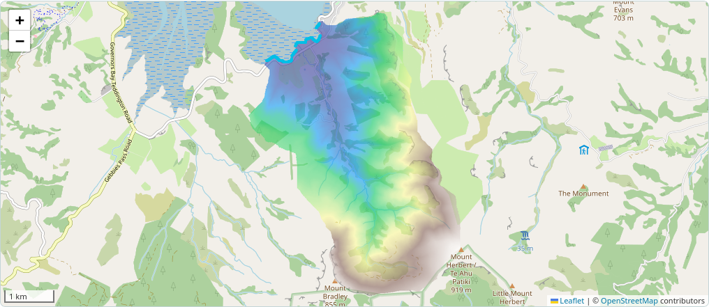

# Spatial inputs, Orton Bradley and the map view

These features are on **main / v0.1.3**. The prepared v0.1.2 distributions
and their verification records are unchanged. Install the current checkout
for this interface:

```bash
python -m pip install -e '.[ui]'
python src/floodwarp/ui.py
```

Select the project's `.venv/bin/python` interpreter in PyCharm. Open
http://127.0.0.1:8765. The same interface starts with `python -m floodwarp.ui`.
No numerical dependency pins changed.

## Default Orton Bradley setup

When the extracted original `orton_bradley_v0.1.0` archive is present in
`outputs/release/orton_bradley_v0.1.0`, `orton_bradley_v0.1.0`, or the launch
directory itself, the interface loads and previews that full-domain setup.
IDE launches from `src/floodwarp` are anchored at the checkout root, so the
archive and normal `outputs/` directory are found there too. An empty or wrong
archive folder produces a selection error rather than a missing Python-source
licence path.

It **does not start a simulation automatically**. Otherwise select the extracted
archive directory using Browse. The page links the existing authorised data
archive; it does not silently download the large dataset. The small synthetic
example remains a separate button and resets the form to ordinary settings.

The preset verifies five retained source SHA-256 identities before preparing
ordinary UI files in `<output parent>/orton-bradley-ui-inputs`:

- The original 1123×843, 5 m DEM and 559,985 active cells; no new conditioning,
  resampling, crop or vertical shift. The DEM is copied byte-for-byte.
- Spatial Manning n and rainfall multipliers, and exponential infiltration
  f0/fd/k fields. Rates stay in original m/s and fd stays in metres; there is no
  mm/h round-trip or replacement with constant infiltration.
- All 578 original SI rainfall nodes, using round-trip FP64 decimal CSV.
  The native finite-support event ends at 48 h, including its nonzero final
  node; rainfall is zero through the remaining 24 h recession.
- Exactly 212 explicitly listed north-facing coastal contacts at absolute
  stage 0 m NZVD2016; other domain interfaces are closed.
- The explicitly selected matched FV1 profile: FP64/contact HLL, CFL 0.4,
  g 9.80665 m/s², dry depth 0.0001 m, dt bounds 1e-6–1 s and
  discharge-extrapolated stage momentum. Ordinary defaults retain velocity
  extrapolation and their existing timestep controls.

The full event is **72 hours of simulated time**, not a quick installation
check. Diagnostics default to 60 s and checkpoints to 3600 s, plus initial and
final checkpoints. Checkpoints use the first diagnostic at/after their interval;
zero means every diagnostic. This avoids writing a full checkpoint every minute
in the full-domain example. Choose the small synthetic setup for a fast run.
The full-domain demonstration is Orton Bradley; the historical `run_purau`
installation crop and the actual Purau catchment remain different cases.

Prepared files include source provenance/data credits and a manifest of original
and derived hashes. Existing prepared files are checked before reuse; edited
files are preserved and cause an error asking for a different output parent.
Source archives, historical results and earlier release assets are read-only.
The soils, terrain conditioning and coastal stage are benchmark assumptions,
not a calibrated forecast or a tide reconstruction.

## Spatial roughness and infiltration

Expand **Model settings** and select a uniform value or an aligned raster.
Manning n must be finite and positive on every active cell, in s/m^(1/3).
Constant infiltration capacity accepts a uniform mm/h value or a spatial
GeoTIFF, with rate units explicitly chosen as mm/h or m/s. Values must be finite
and non-negative; zero is valid. Capacities are passed to the existing
water-availability-limited source treatment, not imposed as water removal.

The exponential option accepts three aligned spatial GeoTIFFs: initial capacity
f0, decay depth fd, and final conductivity k. Rate units are selected explicitly;
fd is always metres. Require positive fd, non-negative f0/k and f0 ≥ k over
active cells. It calls the existing FV1 exponential setter; there is no new soil
law, groundwater coupling or Green-Ampt implementation.

All maps must exactly match DEM CRS, shape, transform and cell spacing and cover
all active cells without NoData. They are never silently resampled or normalised.
The visible summary reports modes/ranges and numerical settings even with the
settings panel collapsed. The run configuration retains exact input hashes and
values; display rounding does not alter the numerical fields.

## Explicit boundaries and coastal stages

Choose **Explicit faces CSV**. First validate the terrain/domain, download the
closed-face template, then edit the desired interfaces. Keep this exact header:

```csv
axis,row,col,type,stage_m
qx,3,16,stage,0.1
qy,0,7,free,
```

`axis` is qx or qy. Indices are zero-based in the **south-first model grid**:
qx shape `(ny,nx+1)`, qy shape `(ny+1,nx)`. qx[row,col] is a vertical face;
qy[row,col] is a horizontal face. A north-up raster cell at row r maps to model
row `ny-1-r`. The template lists all valid domain interfaces, including holes.
Types are `closed`, `free` or `stage`; unlisted interfaces remain closed.
Duplicate faces, out-of-grid indices, internal active/active faces and invalid
stages are rejected. Blank stage values are required for Closed/FREE rows.

Stage means **absolute elevation in metres**, not depth above the bed. Enter its
vertical datum explicitly; it must match the DEM datum. The UI never infers
coastal stages from elevation. A constant stage applies at each selected face;
independent face values are allowed. Time-varying tides/stages remain an ordinary
Python API task. FREE and Closed presets retain their original behaviour;
FREE does not turn enclosed NoData holes into outlets.

The map draws FREE contacts in orange and stage contacts in cyan. Hover over a
contact to see its qx/qy face index. Very large boundary previews are capped at
20,000 segments and report that limit; it never changes the simulated face set.
This is an explicit face-file interface, not a GIS boundary editor.

## Rainfall end convention

Custom CSV defaults still use `time_h,rainfall_mm_h` and an explicit final zero
node. An additional exact-SI convention is `time_s,rainfall_m_s`.
**Last node ends the event** exposes FV1's existing finite-support semantics:
the final node may be nonzero, the event ends there, and recession adds no rain.
It does not append a ramp from the final intensity to the simulation end.
Linear integration within the supplied event is unchanged.

The high-level API exposes the same explicit FV1 choice as
`create_model(..., rainfall_end_behavior='finite_support')`. Its ordinary
`require_coverage` default is unchanged. The non-default choice is recorded in
checkpoint identity; existing default checkpoints remain readable and differing
forcing conventions cannot silently reinterpret an archive.

## OpenStreetMap and result overlays



Leaflet 1.9.4 is bundled locally with its BSD-2-Clause notice. The browser streams
only the viewed OpenStreetMap tiles directly from the standard HTTPS tile
service. Attribution stays visible; no bulk download, prefetch or offline tile
scraping is implemented. Browser HTTP caching is retained. See the
[OSM tile policy](https://operations.osmfoundation.org/policies/tiles/).
Basemap requests disclose the viewed map area to the tile provider; model files
and solver execution stay local. No account or API key is needed.

Choose terrain/domain, maximum depth or final depth after completion, and adjust
overlay opacity. Boundary contacts stay above the raster. Disable the basemap to
use local overlays without internet. A basemap failure does not stop the solver.

Map images are bounded at 768 pixels per axis and reprojected with nearest-neighbour
sampling to Web Mercator **for display only**. Transparent inactive cells preserve
domain holes in the preview. Exact model input/output grids, masks and metre
units remain unchanged in GeoTIFFs; use those files for analysis. `map.json`,
`maximum_map.png` and `final_map.png` are display products, not new hydraulic data.

The run summary/configuration, source checksums, sampled balances, aggregate
boundary flows and atomic restart checkpoint remain available as before. Maximum
maps and simultaneous final depth are separate quantities. Numerical completion
does not establish observed-event accuracy, calibration or grid convergence.


## Runtime and timestep statistics

Each run writes `metrics.json` and streams `runtime.csv` at its diagnostic
interval. The page reports accepted steps and dt min/mean/max in seconds,
hydraulic time and worker wall time. Metrics record the actual software
version/source, resolved device/profile, final time and whether the run completed.
The native step count is checked against the accumulated interval count.

Hydraulic time is the sum of the existing native `loop_seconds` measurements.
It excludes module loading and graph capture, which are recorded separately.
Advance wall time includes the complete successful `advance` calls. Worker wall
time starts at `execute_run` entry: it includes preparation, diagnostics,
checkpoint IO and output creation, but excludes Python process startup and
browser validation. Separate preparation/checkpoint/diagnostic/output timings
make these scopes explicit; they are not an exhaustive profiler partition.

Cumulative dt mean is simulated time divided by accepted steps. Dt min/max
come from accepted native steps; RMS is step-count-weighted across intervals.
No extra solver advances, state snapshots or CFL changes are introduced to
measure them. On failure, completed-interval statistics and flushed CSV rows
remain available with `complete=false`; the existing last complete checkpoint
is preserved. These partial hydraulic totals do not cover a failed advance.

The displayed run is a measurement of its own device and workload, not a
promise of the retained benchmark timing. Basemap/server/browser time and
other applications can affect user experience. [Metric provenance](RUN_METRICS.md)
keeps historical full-event evidence separate from new small controls.
