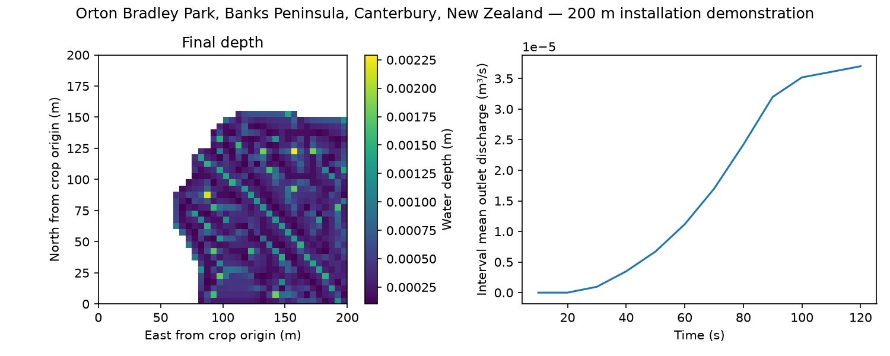

# Orton Bradley Park — 200 m installation demonstration

Run `python -m examples.run_purau` after installation with `.[plot]`. Historical
`purau` file identifiers are retained. This is a **40×40-cell, 200×200 m crop**,
with 759 active cells, not the complete 1123×843 model. See the separate
[full-domain Orton Bradley demonstration](../orton_bradley/README.md).

The crop retains conditioned elevations at north-first rows 112–151 and columns
172–211. Coordinates are NZTM2000 / EPSG:2193; elevations are metres NZVD2016,
confirmed by the owner for v0.1. No elevation adjustment was applied. NumPy
arrays are south-first; the GeoTIFF is north-first. The aligned 1 m underlying
terrain remains available for experimental SGS.

North-facing active/exterior interfaces are FREE; other mask interfaces are
closed. Artificial cut boundaries, illustrative rainfall, zero infiltration
and Manning n=0.035 make this an installation example, not a calibrated forecast.
LI and FV1 run on CPU to 120 s with depths, hydrographs, balances and checkpoints.

Elevation data retain CC BY 4.0. `provenance.json` records original survey URLs,
conditioning/crop history and exported hashes. Single-survey pixel lineage is
not asserted. See [attribution](../../THIRD_PARTY_NOTICES.md).

