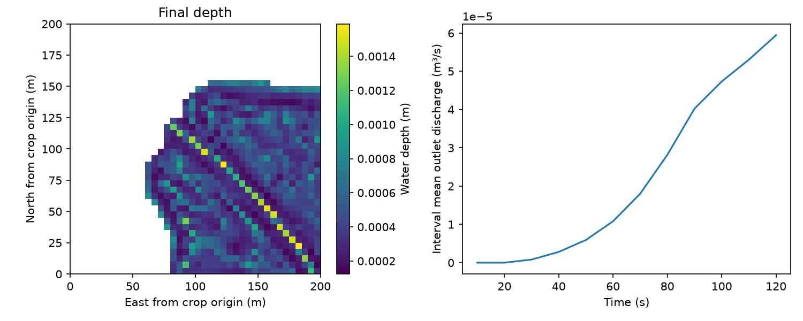

# Purau rainfall demonstration

Run `python -m examples.run_purau` from the checkout after installation with
`.[plot]`. Both LI and FV1 run on CPU. No GIS library or prepared-model loader
is needed for the NumPy example; `terrain.tif` is supplied for independent GIS
inspection and the direct-raster example.

The physical grid has 40×40 cells at 5 m (200×200 m), with 759 active cells.
It crops the existing Purau terrain at north-first rows 112–151 and columns
172–211. The original absolute elevations are retained; this is not synthetic
terrain. The previously conditioned derivative is cropped and row-flipped,
with an aligned 200×200 native 1 m terrain array for optional experimental SGS.

All north-facing active/exterior interfaces are FREE, including the irregular northern mask edge; all other domain/mask interfaces are
closed. These artificial cut boundaries and absent upstream inflow make this
a local rainfall demonstration, not a reconstruction of a full Purau flood.
Rainfall rises to 20 mm/h, ends at 90 s, and is followed by recession to 120 s.
Manning n=0.035 is illustrative, not calibrated. Infiltration is set to zero
for a transparent surface-water balance. Change these controls in the runner.

Outputs include sampled depths, a depth-map/hydrograph figure, interval mean
outlet discharge, cumulative volumes, water-balance diagnostics and restart.

The data are attributed under CC BY 4.0. `provenance.json` contains checked
LINZ catalogue URLs and hashes of the original derivative and exported files.
The original local metadata lists multiple surveys rather than per-pixel
lineage. A direct check against 2018–2019/2023 tiles did not establish exact
pixel identity, consistent with conditioning/resampling or another listed
source. No single-survey identity is asserted.

**Datum limitation:** the derivative's vertical datum was not recorded.
Banks Peninsula survey metadata specify NZVD2016, but the derivative cannot
currently be certified as that datum. This example uses only relative terrain
hydraulics and FREE boundaries. Verify the derivative datum before supplying
external absolute stage data. No vertical shift has been applied.

Verified CPU demonstration outputs:

