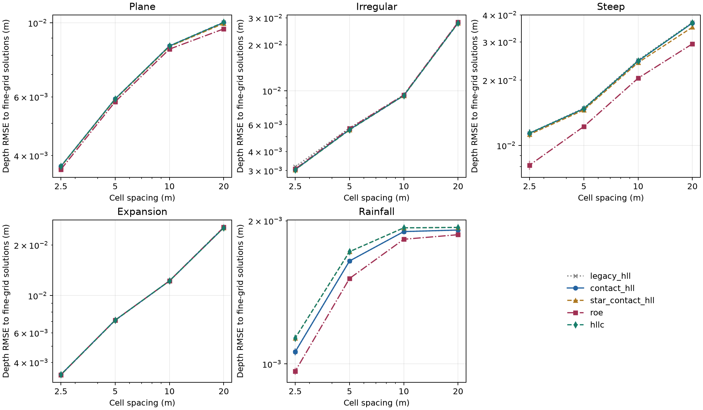
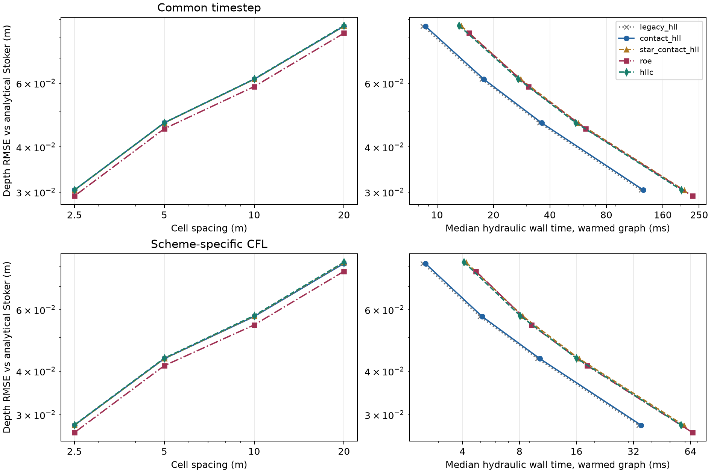

# FloodWarp FV1 flux requalification

**Retain `contact_hll` as the production default.** Roe exactly preserved grid-aligned stationary hydraulic jumps and improved the off-grid jump. On both dam breaks, spending a similar GPU budget on a finer contact-HLL grid produced lower depth error. Corrected HLLC gives the existing contact-upwind formula on wet faces with identical outer speeds. No catchment observations establish a physical-accuracy advantage for any of the alternatives.

This correction starts from `25b6081` on dev. **The original HLLC derivation and its accuracy, stability and performance rankings are superseded.** The original report, HLL audit, case specifications, JSON and figures remain available. Corrected measurements are under `corrected/`. All numerical code was derived within FloodWarp. [Original report at 25b6081](REPORT_25b6081.md) · [Corrected measurement environment](corrected/environment.json)

## What was wrong with HLLC?

Write the normal conservative state as $Q=(h,m,n)=(h,hu,hv)$ and its flux as $F=(m,mu+gh^2/2,mv)$. Across an approximate wave of speed $S$, conservation requires $F_b-F_a=S(Q_b-Q_a)$. For a wet fan spanning the face, integrating conservation across both outer speeds gives

$$Q_H=\frac{S_R Q_R-S_L Q_L-(F_R-F_L)}{S_R-S_L},\qquad F_H=F_L+S_L(Q_H-Q_L)=F_R+S_R(Q_H-Q_R).$$

Let $H=Q_{H,h}$, $M=Q_{H,m}$ and $J=F_{H,h}$. The conservative contact restoration keeps $H,M$ common across the shear wave. Set $Q^*_K=(H,M,Hv_K)$ and compute $F^*_K=F_K+S_K(Q^*_K-Q_K)$. The first two components on either side equal the first two components of $F_H$. The transverse component is $Jv_K$ because the outer mass balance gives $J=m_K+S_K(H-h_K)$. The middle jump therefore satisfies $F^*_R-F^*_L=(J/H)(Q^*_R-Q^*_L)$. This establishes all three jump relations with middle speed $S_*=J/H$. The two outer bounds enclose both wet velocities, so $H>0$ and $S_*$ lies between the outer speeds. The one-sided fans return the upwind physical flux. HLL star fluxes and states satisfy these integral identities; an approximate star flux need not equal the physical flux evaluated at the HLL state. [Published shallow-water HLLC flux, §2.5, equations 25–32](https://www.mdpi.com/2077-1312/13/11/2036) · [Toro, *Shock-Capturing Methods for Free-Surface Shallow Flows*](https://www.wiley-vch.de/en/areas-interest/engineering/mechanical-engineering-10me/fluid-mechanics-10me3/shock-capturing-methods-for-free-surface-shallow-flows-978-0-471-98766-6)

The previous implementation substituted $HS_*=J$ for $M$. Those quantities generally differ. For the requested 2 m / 0.4 m discontinuity at rest, $g=9.81$, the experimental bounds are −4.42945 and 5.65372 m/s. $H=1.10287$ m, $M=1.86799$ m²/s and $J=3.97381$ m²/s. The old left/right star normal fluxes are **2.01824 and 23.25157 m³/s²**. A middle wave with zero normal-momentum jump cannot support that flux difference. The corrected outer constructions both give **11.34586 m³/s²**. The old finite-volume update still shared one face flux between cells, so a global water-budget test alone could miss the defect.

The corrected Warp branch evaluates the conservative HLL longitudinal flux and upwinds tangential velocity on the middle wave. NumPy uses the sign of $J$ directly. This is the same wet contact treatment as `contact_hll` for common outer bounds. The experimental variant retains its wider endpoint-plus-positive-two-rarefaction envelope and explicit shallow HLL fallback. FloodWarp's `star_contact_hll` uses its existing star speed estimate. These choices explain remaining differences. Alternative choices for the approximate outer waves need not give identical numerical fluxes. HLLC checkpoints now carry revision 2. Loading a pre-correction experimental HLLC checkpoint raises an explicit error. Existing HLL and Roe checkpoints keep their prior identity. [Warp fluxes](../../src/floodwarp/full_swe_kernels.py) · [Independent NumPy fluxes](../../src/floodwarp/full_swe_reference.py)

## Roe, conservation and independent verification

Roe retains the square-root-depth velocity averages, $c^2=g(h_L+h_R)/2$, the two gravity eigenvectors and the transverse momentum eigenvector. The independent test solves the three-by-three characteristic system and checks $\sum_i\lambda_i W_i=F_R-F_L$. For a transonic gravity wave with edge speeds $a<0<b$, it solves $w_a+w_b=1$, $aw_a+bw_b=\lambda$ and adds $aw_a W$ to the left flux. It computes the intermediate depth, tests the wave brackets and predicts the outcome code independently. Both CPU and CUDA passed on 600 seeded pairs spanning four orders of depth with opposing and supercritical velocities. The sample exercised unsplit Roe, entropy-corrected Roe and inadmissible HLL. A further 1,000 pairs tested normal reversal and physical-flux consistency for each solver. The HLLC test reconstructed the two outer RH updates and the middle jump on 500 seeded interfaces. [Verification tests](../../tests/test_fv1_research_fluxes.py) · [Roe (1981)](https://doi.org/10.1016/0021-9991(81)90128-5) · [Harten and Hyman (1983)](https://doi.org/10.1016/0021-9991(83)90066-9)

Forty conjugate-depth pairs with Froude numbers 1.1–5 gave the stationary physical flux under Roe with zero fallback. The donor-limited, reflecting 2D basin test retained nonnegative depth and total volume and reproduced the rotated conservative solution. Tiny positive depths, vacuum-producing velocity contrasts, one-sided fans, wet/dry walls, sparse/dense checkpoint continuation and irregular lake shorelines are covered. Both alternatives retain the shared hydrostatic reconstruction, Euler update, draining limiter and shallow momentum policy audited in the original report. The largest normalized analytical water-balance residual was $7.53\times10^{-16}$. No analytical run reported a negative depth.

## Analytical results

All 360 combinations completed on CUDA with the original exact solutions, break-aware cell averages, boundaries and measurement windows. The four common timestep runs at 20, 10, 5 and 2.5 m used 0.25, 0.125, 0.0625 and 0.03125 s. The second matrix used the production CFL. Depth, wet-region, velocity, momentum, variation and feature errors are retained per run. The four non-HLLC schemes reproduced the archived analytical depth RMSEs, ledgers and flux outcome counts. [Corrected analytical data](corrected/analytical.json)

| 5 m, common timestep | Legacy HLL | Contact-HLL | Star contact-HLL | Roe | Corrected HLLC |
|---|---:|---:|---:|---:|---:|
| Ritter depth RMSE (m) | .03220 | .03220 | .03234 | .03130 | .03234 |
| Stoker depth RMSE (m) | .04663 | .04663 | .04659 | .04491 | .04667 |
| Aligned jump depth RMSE (m) | .06068 | .06068 | .06000 | 0 | .06068 |
| Off-grid jump depth RMSE (m) | .04201 | .04201 | .04165 | .01178 | .04201 |
| Lake depth RMSE (m) | 0 | 0 | 0 | 0 | 0 |
| Thacker depth RMSE (m) | .02343 | .02343 | .02343 | .02348 | .02343 |
| Manufactured depth RMSE (mm) | .15739 | .15739 | .15739 | .15737 | .15739 |
| Moving shear transverse momentum RMSE (m²/s) | .19896 | .15601 | .15601 | .15601 | .15601 |
| Stationary shear transverse momentum RMSE (m²/s) | .22451 | 0 | 0 | 0 | 0 |

| 5 m feature or momentum metric | Contact-HLL | Roe | Corrected HLLC |
|---|---:|---:|---:|
| Ritter front offset at 1 cm (m) | −26.85 | −23.23 | −27.27 |
| Ritter normal momentum RMSE (m²/s) | .12426 | .11642 | .12520 |
| Stoker shock offset (m) | +.788 | +1.133 | +.772 |
| Stoker normal momentum RMSE (m²/s) | .17590 | .16952 | .17611 |
| Off-grid jump position offset (m) | −1.289 | +.036 | −1.289 |
| Off-grid jump normal momentum RMSE (m²/s) | .08941 | .07052 | .08940 |
| Thacker left / right shoreline offset (m) | +1.03 / +36.70 | +1.00 / +36.87 | +1.03 / +36.74 |

The 5→2.5 m observed depth orders for contact-HLL / Roe / HLLC were 0.557 / 0.542 / 0.559 for Ritter, 0.617 / 0.618 / 0.618 for Stoker, and 0.828 / 0.829 / 0.828 for Thacker. All three gave 0.998 on the smooth manufactured solution. Roe's sharper jump and slightly lower dam-break RMSE coexist with greater Stoker shock-position error and a similar receding-shoreline tail on Thacker. The equilibrium and exact stationary shear have zero error, so an observed order is undefined.

## Synthetic grid refinement

The repeat used the same analytic terrain functions, sources and cell spacings. All 240 Warp runs completed, including timestep halvings. Ten independent NumPy legacy-HLL runs provided a second implementation. The table uses contact-HLL's last spatial gap at a common dt and the finest contact-HLL timestep-halving difference. The cross-formulation gap compares the 0.625 m contact-HLL and Roe solutions. These differences measure reference sensitivity and give no rigorous upper bound on continuum error. [Grid fields and reference checks](corrected/grid.json) · [Observed orders for all five schemes](corrected/grid_rates.json)

| Domain | 1.25→0.625 m spatial gap (mm) | Finest dt-halving (mm) | Finest cross-formulation gap (mm) |
|---|---:|---:|---:|
| Plane | 1.757 | .029 | .033 |
| Irregular | 1.240 | .016 | .105 |
| Steep | 5.050 | .074 | 2.188 |
| Expansion | 1.402 | .022 | .033 |
| Rainfall | .470 | .002 | .142 |

The irregular-domain practical-grid comparison below separates 10 m Roe from 5 m contact-HLL against both fine references. At equal resolution, many scheme differences are smaller than the last reference refinement. A physical-accuracy ranking at that precision remains inconclusive.



## GPU costs and CFL parity

The revised star CFL reduction computes the local source-depth interval once per cell and reuses it for the four faces. It skips the exponential when its coefficient is exactly zero and evaluates the wave envelope in the required face orientation once. The neighboring cell, bed sill, stage ghost, possible source-depth range, dry rarefaction and unsplit two-direction bound all retain their original formulas. This uses local registers and adds no device allocation or kernel launch. A direct comparison with the frozen pre-change reduction exercised nonuniform terrain, source fields, dry states, extreme velocities, masks and all three stage modes. The maximum dt difference was zero in 128 randomized grids on CPU and 128 on CUDA. An adaptive expansion replay gave bit-identical final states and identical step counts. [Paired measurements and CFL checks](corrected/cost_controls.json)

On a 5 m expansion, seven interleaved old/new comparisons measured a median **44.90→34.48 µs** per additional Roe CFL kernel and **5.62→5.17 ms** per adaptive hydraulic run including graph capture. The corresponding graph-loop times were 5.23→4.78 ms. This is an 8% wall-time reduction on this workload. The star bound and the Roe face solve still carry substantial costs. The non-instrumented five-scheme profile follows.

| 5 m expansion, µs per accepted step | Legacy HLL | Contact-HLL | Star contact-HLL | Roe | Corrected HLLC |
|---|---:|---:|---:|---:|---:|
| Both face kernels | 26.09 | 27.81 | 29.94 | 39.99 | 29.79 |
| Additional star CFL | 0 | 0 | 34.51 | 34.54 | 34.48 |
| All hydraulic kernels | 78.90 | 80.50 | 117.73 | 127.88 | 117.62 |

| Adaptive 5 m Stoker, 128 × 64 | Steps | Mean / min dt (s) | Warm wall (ms) | Million cell-steps/s | Graph capture (ms) | Depth RMSE (m) |
|---|---:|---:|---:|---:|---:|---:|
| Legacy HLL | 142 | .2254 / .1676 | 9.99 | 116.5 | .256 | .04343 |
| Contact-HLL | 142 | .2254 / .1676 | 10.26 | 113.4 | .244 | .04343 |
| Star contact-HLL | 146 | .2192 / .1058 | 16.49 | 72.5 | .261 | .04346 |
| Roe | 147 | .2177 / .1704 | 18.24 | 66.0 | .261 | .04146 |
| Corrected HLLC | 146 | .2192 / .1059 | 15.98 | 74.8 | .267 | .04357 |

FP64 on one RTX 4070 Ti SUPER, seven rotated repetitions, explicit synchronization and reused CUDA graphs. Peak incremental live CUDA-pool usage was 2.043 MiB for all five at this grid size. The common dense hydraulic module took 0.473 s to compile and load with an empty Warp kernel cache. The separate measurement includes neither a timestep nor graph capture. Kernel profiling used uncaptured launches. Catchment replay wall times are single runs and carry no comparative performance ranking. [Repetitions, quartiles, kernel timings, memory and throughput](corrected/gpu.json) · [Compile measurement](corrected/compile.json)

| Common-dt comparison | 10 m Roe error (m) / wall (ms) | 5 m contact-HLL error (m) / wall (ms) | Lowest measured error under stated budget |
|---|---:|---:|---|
| Ritter | .04407 / 30.88 | .03220 / 33.67 | 35 ms, contact-HLL and legacy HLL |
| Stoker | .05871 / 30.74 | .04663 / 36.12 | 37 ms, contact-HLL and legacy HLL |
| Aligned stationary jump | 0 / 15.02 | .03716 / 17.32 | 18 ms, Roe |
| Off-grid stationary jump | .00970 / 15.02 | .02575 / 17.31 | 18 ms, Roe |
| Irregular synthetic catchment | .009389–.009399 / 14.40 | .005564–.005574 / 16.18 | 17 ms, contact-HLL has the smallest measured fine-reference discrepancy |

Budgets admit both listed alternatives and compare the discrete runs within each budget. Stoker includes four spacings. The additional cost tests compare all five schemes on 10 and 5 m grids. Shock timings use a 640 × 320 m domain and whole-domain RMSE. The analytical shock table above uses the central ±120 m measurement window. The two error norms serve different comparisons. With adaptive timesteps, 10 m Roe on Stoker achieved .05425 m at 9.26 ms versus .04343 m at 10.26 ms for 5 m contact-HLL. Hardware, domain shape and the user’s target error influence this trade-off. [Additional repetitions and reference-specific errors](corrected/cost_controls.json)



## Orton Bradley and hydraulically active fallback

All five schemes completed the installation crop and matched continuations from the archived hour-25 checkpoint on the 559,985-active-cell domain. Physical inputs, stages, starting state, output intervals and wet threshold were identical. The separate Purau catchment lacked runnable matched inputs. On the historical 600 s window, the three existing HLL schemes and Roe exactly reproduced the archived hydrographs, ledgers, maximum depths and relative-field error metrics. Correcting HLLC changed its peak from 76.036 to 75.655 m³/s and its export from 41,977.87 to 41,862.96 m³. The table covers the longer 1,200 s continuation. [600 s repeat](corrected/catchment_600s.json) · [1,200 s hydrographs, diagnostics and input hashes](corrected/catchment.json)

| Scheme | Max depth (m) | Max-envelope area >1 cm (m²) | Final depth RMSE vs contact-HLL (mm) | Peak 60 s outward flow (m³/s) | Export (m³) | Wet speed P95 (m/s) | Jump candidates at end |
|---|---:|---:|---:|---:|---:|---:|---:|
| Contact-HLL | 3.75435 | 1,404,300 | 0 | 75.298 | 77,487.1 | 1.558 | 62 |
| Legacy HLL | 3.75434 | 1,405,025 | 1.998 | 73.929 | 76,083.2 | 1.569 | 62 |
| Star contact-HLL | 3.75469 | 1,404,825 | .361 | 75.694 | 77,746.3 | 1.553 | 63 |
| Roe | 3.75354 | 1,405,625 | 1.558 | 73.836 | 76,510.3 | 1.558 | 75 |
| Corrected HLLC | 3.75469 | 1,404,800 | .351 | 75.655 | 77,730.2 | 1.554 | 62 |

The maximum 60 s interval mean fell in the first interval for every scheme. Event peak timing and agreement with observed floods remain untested. The final 1 cm extent symmetric difference against contact-HLL was 5,775 m² for Roe and 1,900 m² for HLLC. Corresponding x/y velocity RMSEs in jointly wet cells were .0196/.0187 and .0040/.0038 m/s. The largest absolute window balance residual was below $2\times10^{-9}$ m³. These are matched inter-model comparisons.

The opt-in validation replay classifies post-source, hydrostatically reconstructed **interior** face pairs at every accepted step. The count excludes pairs with zero depth on both sides. Weights use actual donor-limited fluxes: absolute volume is $\sum |F_h|\Delta t L$ and momentum weight is $\sum\|(F_{hu},F_{hv})\|_2\Delta t L$, including pressure traction. These weightings count internal exchanges, so their totals exceed outlet volume. The original scalar outcome counts include boundary faces. Each instrumented replay checks bitwise final-state agreement with its uninstrumented run. Ordinary runs allocate no detailed counters and execute no detailed diagnostic kernels. [Diagnostic kernels and grouping](../fv1_riemann_transport.py)

| Roe reconstructed depth band, deeper side | Interior face-steps | Fallback share of faces | Fallback share of volume | Fallback share of momentum |
|---|---:|---:|---:|---:|
| 0–1 mm | 2,393,681,933 | 99.93% | 99.98% | 99.91% |
| 1–10 mm | 6,561,844,109 | 99.77% | 99.85% | 99.44% |
| 10–100 mm | 531,910,003 | 92.23% | 91.52% | 80.35% |
| 100 mm–1 m | 146,223,819 | 33.04% | 26.55% | 14.21% |
| ≥1 m | 15,612,704 | .022% | .036% | .025% |

| Subset | Roe HLL fallback, face / volume / momentum share | HLLC HLL fallback, face / volume / momentum share |
|---|---:|---:|
| All evaluated interior faces | 98.22 / 23.91 / 6.87% | 98.22 / 23.53 / 6.75% |
| Adjacent to fixed channel proxy | 50.83 / 16.12 / 6.28% | 50.95 / 15.81 / 6.15% |
| Both sides ≥1 cm | .052 / .060 / .035% | 0 / 0 / 0% |
| Hydraulic-jump proxy | 0 / 0 / 0% | 0 / 0 / 0% |

The fixed channel proxy selects the 11,057 initially wet cells with depth ≥0.1 m and discharge magnitude ≥0.05 m²/s. The per-step jump proxy selects jointly wet compressive faces with flow in the same direction, a transition in **normal** Froude number from above to below one, and increased downstream depth. These are reproducible spatial/hydraulic selections without an independently surveyed channel or jump inventory. The final-state jump-candidate count in the catchment table retains the historical stronger thresholds and cell-speed definition. All bands and selection thresholds for wet cells and channel locations are set in the catchment harness.

Of interior Roe evaluations, 0.00086% fell back for inadmissibility (0.0453% of volume). Entropy-corrected Roe accounted for 0.189% of evaluations, 11.21% of volume and 9.18% of momentum weight. Combining ordinary and entropy-corrected Roe gives **76.09% of absolute transported volume** and **93.13% of momentum weight**. On faces adjacent to the channel proxy, Roe handled 83.88% of volume. On jump-proxy faces it handled all measured volume. The extended window therefore establishes where Roe operated and leaves the physical correctness of the resulting hydrograph open.

## Engineering decision and coverage

- **HLLC.** The original normal-momentum closure violated the middle jump condition. The corrected contact restoration is algebraically equivalent to the existing wet contact-upwind treatment under identical outer bounds. The extra speed bound offered no consistent accuracy advantage here.
- **Roe.** Its stationary-shock advantage survived the independent characteristic, entropy, conjugate-depth and whole-solver tests. The conditional HLL fallback matters at moving wet/dry interfaces. Ritter and Thacker give different rankings, which precludes a universal shoreline recommendation.
- **Cost.** The reduced CFL workload lowered Roe wall time while preserving the measured stability envelope. Contact-HLL still achieved lower dam-break error at the representative fixed budgets. Roe was competitive for stationary shocks. Equal-cost physical accuracy over observed catchments remains unresolved.
- **Next development priority.** Qualify a separate conservative, positive, well-balanced second-order finite-volume method before adding further first-order flux variants. The preserved MUSCL/SSP-RK2 experiment reduced 5 m smooth-shear RMSE from .01688 to .00250 m²/s at about seven times the CPU cost. It exercises one characteristic with constant depth and normal velocity. Moving-shoreline accuracy, irregular-bed balance and fixed-GPU-budget gains for a full second-order flood solver remain untested. [Preserved second-order measurements](order.json)

**Coverage.** All 360 analytical runs, 240 synthetic Warp runs, 10 synthetic NumPy runs, 40 Stoker cost groups, 40 additional cost groups and the matched catchment windows completed. No completed comparison failed a numerical gate. The full CUDA-enabled regression command returned **1,773 passed, 26 skipped, 743 warnings**. The separate Purau case, field validation, full-event peak timing and a general second-order solver remain untested. The finite-resolution synthetic comparators only support differences larger than their observed uncertainty.

## Reproduce

Run from the repository root using the pinned Python 3.14 environment with CUDA and the plotting dependencies. Keep the GPU free of concurrent hydraulic workloads for timing. The catchment module reruns both windows when the input archive is available. Its JSON records the checkpoint SHA-256. The supplemental cost module reads the corrected grid results and compares the archived and optimized reductions on the same hardware. The first-order scripts write under `corrected/`. The second-order evidence remains in the original directory.

```sh
python -m validation.fv1_riemann
python -m validation.fv1_riemann_compile
python -m validation.fv1_riemann_gpu
python -m validation.fv1_riemann_cost_controls
python -m validation.fv1_riemann_catchment
python -m validation.fv1_riemann_figures
OVERLANDER_TEST_FULL_SWE_CUDA=1 python -m pytest -q
```
