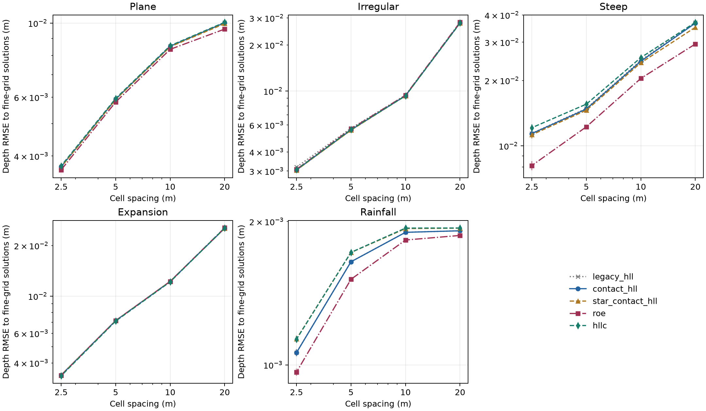
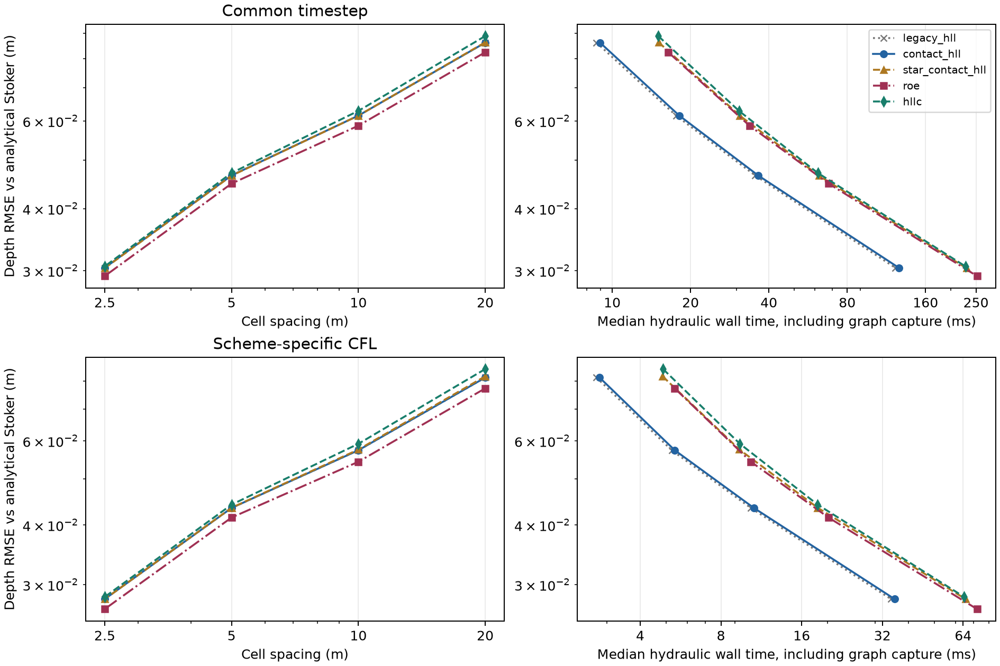

# FloodWarp FV1 Riemann flux investigation

**Decision. Retain `contact_hll` as the production default.** Roe is a useful experimental option for sharp hydraulic jumps. Its depth RMSE improvement was modest on propagating dam breaks, and it needed a finer grid than 10 m to reach 5 m contact-HLL accuracy in the GPU Stoker benchmark. Full HLLC provided the same shear-wave resolution as contact-HLL at a higher GPU cost. The catchment evidence shows sensitivity to the flux, with no independent observations for ranking physical accuracy.

The investigation starts from `origin/dev` at `77dc855b544ecb98a25584fa214db7e41b50e6be`. The Warp implementations and independent FP64 NumPy expressions use the published mathematics. The new code was written in this repository under its existing licence. Existing Patrick Durney / Lincoln Agritech Ltd software attribution and separate terrain attribution apply. [Third-party notices](../../THIRD_PARTY_NOTICES.md) · [Orton Bradley data licence](../../examples/orton_bradley/DATA_LICENSE.md)

## 1. Existing FV1 operators

For an oriented face, use $Q=(h,hu,hv)$, where $u$ is normal velocity and $v$ transverse. The physical flux is $F=(hu,hu^2+gh^2/2,huv)$. At y faces the kernel interchanges the momentum components before and after evaluating the flux. Let $c=\sqrt{gh}$, and let $S_L,S_R$ denote estimated outer speeds. HLL uses the upwind physical flux if the fan lies on one side of the face. In the fan it uses

$$
 F_{HLL} = \frac{S_R F_L-S_L F_R+S_L S_R(Q_R-Q_L)}{S_R-S_L}.
$$

| Flux | Wet outer speeds | Transverse momentum in the HLL fan |
|---|---|---|
| `legacy_hll` | $S_L=\min(u_L-c_L,u_R-c_R)$, $S_R=\max(u_L+c_L,u_R+c_R)$ | HLL on all three conserved components |
| `contact_hll` | Same endpoint speeds | $F_h v_{up}$, upwinded by the middle-speed sign |
| `star_hll` | If the two-rarefaction predictor is positive, $S_L=\min(u_L-c_L,u_*-c_*)$, $S_R=\max(u_R+c_R,u_*+c_*)$. Otherwise endpoint bounds | HLL on all three components |
| `star_contact_hll` | Same as `star_hll` | Same middle-wave treatment as `contact_hll` |

The two-rarefaction estimates are $c_*=(c_L+c_R)/2+(u_L-u_R)/4$ and $u_*=(u_L+u_R)/2+c_L-c_R$. The contact estimate is $(S_R d_L+S_L d_R)/(d_L+d_R)$ with $d_L=h_L(u_L-S_L)$ and $d_R=h_R(S_R-u_R)$. If the denominator is nonpositive, the contact variants retain the HLL transverse flux. All four historical variants use wet-side dry-fan speeds $(u_L-c_L,u_L+2c_L)$ at a right dry state and $(u_R-2c_R,u_R+c_R)$ at a left dry state. This speed switch uses `dry_depth`. Face flux and pressure are skipped for two exactly zero reconstructed depths, after constructing any boundary ghost. [Harten, Lax and van Leer (1983)](https://doi.org/10.1137/1025002) · [Warp kernels](../../src/floodwarp/full_swe_kernels.py)

- **Bed and bed source.** At $z_f=\max(z_L,z_R)$ reconstruct $h'_i=\max(0,h_i+z_i-z_f)$, scaling discharges by $h'_i/h_i$ above the velocity cutoff. The momentum update differences the shared flux after subtracting the appropriate side's $gh_i'^2/2$. The omitted cell-local hydrostatic pressure cancels between opposite faces. [Audusse et al. (2004)](https://doi.org/10.1137/S1064827503431090)
- **Time and sources.** FV1 performs a source update, face fluxes and a single unsplit forward Euler transport step, followed by semi-implicit vector Manning drag. Piecewise-linear rain is integrated over the accepted interval. Rain adds zero momentum and dilutes velocity. Constant and explicit cumulative-infiltration-dependent capacities are bounded by available water, with proportional momentum withdrawal. Optional culvert exchange follows the surface step and was outside this study. The analytical trials use zero drag and infiltration. [Solver](../../src/floodwarp/full_swe_solver.py) · [Independent NumPy step](../../src/floodwarp/full_swe_reference.py)
- **CFL.** Endpoint schemes reduce a cap using $CFL/[(|u|+c)/\Delta x+(|v|+c)/\Delta y]$, with rain and stage-ghost bounds. Star schemes also use a face-based envelope over reconstructed source-depth intervals, endpoint and star speeds and dry rarefaction speeds. Roe and HLLC use that extra envelope. A characteristic stage with sources adds a further bound. Accepted steps are capped at forcing knots, requested output time and configured maximum dt. The accepted CFL parameter lies in $(0,0.45]$. The configured minimum dt rejects an inadequate stability bound instead of overriding it.
- **Draining and wet/dry.** Each donor cell computes the lesser of one and the ratio of available depth to requested outward transport. Every adjacent receiver uses the same donor-limited shared flux. Positive film depth stays in the mass ledger. The existing state update zeros momentum at or below `dry_depth`, reports nonfinite states and depth below $-10^{-12}$ m as failures, and removes roundoff-scale negative depth. The experiments check the ledger independently of that tolerance.
- **Boundaries.** Closed exterior and mask faces mirror normal momentum and enforce zero advective flux. FREE faces copy the interior state, suppress incoming transport and retain hydrostatic traction when blocked. Stage faces prescribe ghost depth above the local bed. Options extrapolate velocity (default), extrapolate discharge (historical), or combine stage with an outgoing characteristic invariant. The last has transparent supercritical outflow, a critical outlet when tailwater is sufficiently low, and rejects unsupported supercritical or dry-land inflow.
- **Selection and restart.** The native `FullSWESolver`, `create_overland_solver` and `create_model` accept `flux_scheme`. The resolved scheme remains part of checkpoint identity. The existing flux IDs and control-array format for the four historical fluxes are retained. Dense and exact-sparse scheduling share the face operator. The audit reused the Stoker star relation and existing parity, analytical, restart and profile infrastructure. [Factory](../../src/floodwarp/solver_factory.py) · [Earlier Stoker verification](../analytical_convergence.py) · [CUDA benchmark infrastructure](../sparse_fv1_benchmark.py)

## 2. New experimental fluxes

**Roe.** The averages $\tilde u,\tilde v$ use $\sqrt{h_L},\sqrt{h_R}$ weights and $\tilde c=\sqrt{g(h_L+h_R)/2}$. Eigenvalues are $\tilde u-\tilde c,\tilde u,\tilde u+\tilde c$, with vectors $(1,\tilde u-\tilde c,\tilde v),(0,0,1),(1,\tilde u+\tilde c,\tilde v)$. For jumps $(\Delta h,\Delta m,\Delta n)$, the gravity-wave strengths are $[\Delta h\mp(\Delta m-\tilde u\Delta h)/\tilde c]/2$ and the shear strength is $\Delta n-\tilde v\Delta h$. The Warp flux uses left-going fluctuations. NumPy computes the centred flux minus characteristic dissipation. When the appropriate gravity characteristic crosses zero between its two Roe wave-edge states, the Harten–Hyman split replaces the negative fluctuation coefficient by $a(b-\lambda)/(b-a)$ for bracket speeds $a<0<b$. This maintains the summed wave and its linear flux difference. The intermediate depth must exceed `dry_depth`. An unbracketed entropy split, wave speeds outside the CFL envelope, or an inadmissible intermediate depth invokes HLL. [Roe (1981)](https://doi.org/10.1016/0021-9991(81)90128-5) · [Harten and Hyman (1983)](https://doi.org/10.1016/0021-9991(83)90066-9)

**Full HLLC.** The wet outer speeds enclose both endpoint characteristics and the corresponding positive two-rarefaction speeds. Put $h_*=(d_L+d_R)/(S_R-S_L)$ and $S_*=(S_Rd_L+S_Ld_R)/(d_L+d_R)$. Across the middle shear wave, depth and normal momentum are continuous. Each star state is $Q_{*K}=(h_*,h_*S_*,h_*v_K)$. The flux uses the Rankine–Hugoniot update $F_K+S_K(Q_{*K}-Q_K)$ on the star side selected by $S_*$, with outer upwinding as usual. Require a finite star depth above the cutoff and $S_L<S_*<S_R$ in a straddling fan. For identical admissible outer speeds, these jump conditions give the same mass and normal momentum flux as HLL and the same transverse flux as contact-upwind HLL. Differences between the implemented variants arise from wave bounds, fallback choices and FP64 arithmetic. [Toro (2001)](https://www.wiley-vch.de/en/areas-interest/engineering/mechanical-engineering-10me/fluid-mechanics-10me3/shock-capturing-methods-for-free-surface-shallow-flows-978-0-471-98766-6)

**Shared fallback.** At shallow interfaces both fluxes use an HLL envelope enclosing endpoint characteristics and the applicable dry-front speeds. It retains the reconstructed mass, momentum and pressure, including a positive film. For a straddling fan the HLL intermediate depth is $(d_L+d_R)/(S_R-S_L)$, nonnegative because the bounds enclose the endpoint velocities. The same envelope is used for inadmissible wet faces. The enclosing speed estimate, combined CFL control and existing conservative draining limit provide the positivity protection. The optional outcome counters classify evaluated nonzero-depth faces as shallow HLL, inadmissible HLL, entropy-corrected Roe, or the ordinary selected flux. They include boundary faces and count face evaluations across steps.

## 3. Analytical verification

Five fluxes, four spacings (20, 10, 5 and 2.5 m) and two timestep policies completed **360 runs**. The common steps at those spacings were 0.25, 0.125, 0.0625 and 0.03125 s. Every common-policy run accepted exactly the requested dt. The adaptive runs use CFL 0.4 and the native 1 s ceiling. All trials use the same FP64 reconstruction, Euler update and boundary/source operators. Integration of exact cell averages splits quadrature at discontinuities and shorelines. The lake equilibrium uses the exact stage over the represented bed. Wet masks and reported fronts use a common 0.01 m threshold. Velocity RMSE uses cells wet in both fields. Total variation, overshoot, numerical feature widths, intermediate Stoker states, midpoint-to-final propagation, and both net balance and exact-volume differences are retained in the results. [Analytical results](analytical.json)

| Case, 5 m common dt | `legacy_hll` | `contact_hll` | `star_contact_hll` | Roe | HLLC |
|---|---:|---:|---:|---:|---:|
| Ritter depth RMSE (m) | 0.03220 | 0.03220 | 0.03234 | **0.03130** | 0.03401 |
| Stoker depth RMSE (m) | 0.04663 | 0.04663 | 0.04659 | **0.04491** | 0.04716 |
| Thacker depth RMSE (m) | 0.02343 | 0.02343 | 0.02343 | 0.02348 | **0.02340** |
| Lake at rest depth RMSE (m) | 0 | 0 | 0 | 0 | 0 |
| Forced smooth depth RMSE (mm) | 0.15739 | 0.15739 | 0.15739 | 0.15737 | 0.15739 |
| Moving shear transverse momentum RMSE (m²/s) | 0.19896 | 0.15601 | 0.15601 | 0.15601 | 0.15601 |
| Stationary shear transverse momentum RMSE (m²/s) | 0.22451 | 0 | 0 | 0 | 0 |
| Aligned hydraulic jump depth RMSE (m) | 0.06068 | 0.06068 | 0.06000 | **0** | 0.06326 |
| Off-grid hydraulic jump depth RMSE (m) | 0.04201 | 0.04201 | 0.04165 | **0.01178** | 0.04405 |

| Extracted feature at 5 m, common dt | `contact_hll` | Roe | HLLC |
|---|---:|---:|---:|
| Ritter front position error (m, negative is behind) | −26.85 | **−23.23** | −29.82 |
| Ritter 95%-depth rarefaction head error (m) | −18.20 | **−16.96** | −19.19 |
| Stoker shock position error (m) | +0.79 | +1.13 | **+0.56** |
| Stoker shock propagation error from midpoint (m) | −0.09 | −0.09 | −0.05 |
| Stoker numerical shock 10–90% width (m) | 26.87 | **26.00** | 26.16 |
| Thacker left / right shoreline error (m) | +1.03 / +36.70 | +1.00 / +36.87 | +1.07 / +35.93 |
| Off-grid stationary jump position error (m) | −1.29 | **+0.04** | −1.39 |

Ritter and Stoker use flat-bed dam releases into zero and 0.4 m tailwater with a 2 m reservoir. Thacker uses a frictionless parabolic trough and an exact translating depth parabola with harmonic centre motion. The left and right shoreline errors are strongly asymmetric in this Thacker phase, with a thin numerical tail along the receding side. At 5 m, Roe used shallow HLL on 8.43% of Ritter faces and 2.96% of Thacker faces. HLLC used it on 8.57% and 2.96%. Roe corrected 0.47% and 1.10% of faces for transonic rarefaction. The largest analytical relative mass residual across the suite was below (10^{-15}). [SWASHES, Delestre et al. (2013)](https://doi.org/10.1002/fld.3741) · [Thacker (1981)](https://doi.org/10.1017/S0022112081001882)

The smooth manufactured test uses constant (u=1.25) m/s and (h=0.8\exp(x/640)). Prescribe rain (R=u h_x) and (z=-h-(u^2/g)\log(h/0.8)). Then $(hu)_x=R$ and $(hu^2+gh^2/2)_x=-gh z_x$, with zero horizontal momentum input from rain. It exercises the ordinary rainfall and hydrostatic operators. Measure in the central ±120 m to isolate finite-domain boundary implementation differences. Contact-HLL gave 0.6262, 0.3141, 0.1574 and 0.0788 mm RMSE, about first-order across the four grids. The other schemes gave the same order and nearly identical errors.

The shear tests initialise constant depth and normal velocity, with constant stage at all edges to admit the uniform throughflow and preserve the y-invariant solution. The stationary exact cell averages show a 4.0 m interpolated 10–90% transition on the 5 m grid. Contact-HLL, Roe and HLLC preserve that width. Legacy HLL widens it to 57.37 m. At 1.5 m/s shear advection, all contact-aware variants give 39.45 m compared with 57.16 m for legacy HLL and a 7.92 m interpolated width in the exact cell averages. A reflecting end boundary in the initial moving-shear setup introduced gravity waves into the error norm. The retained results use compatible stage boundaries.

The jump benchmark uses conjugate depths at a constant discharge with upstream Froude 2.25 in a horizontal, frictionless channel. The depth ratio is $(\sqrt{1+8Fr_1^2}-1)/2$, which enforces the mass and momentum jump conditions. Reservoirs at the two ends carry the corresponding depths and discharge. The staged ghosts keep the matching end states, and reservoir lengths isolate the measurement window for 16 s. This permits a supercritical inlet without adding a general prescribed-discharge boundary to FV1. The jump is at 0 or 13.75 m, with exact mixed cell averages for the latter. Roe gives the exact grid-aligned stationary shock since its gravity wave has zero speed. Its 5 m off-grid depth error was 72% lower than contact-HLL, with no HLL fallback in either 5 m jump. This tests stationary shocks in a horizontal reach. An accelerating flow over a bump with a dynamically selected jump would require a separate boundary and forcing qualification.

## 4. Synthetic grids and reference uncertainty

The five 320 × 160 m domains are a smooth sloping plane, an irregular catchment, a steep supercritical channel, a lateral expansion, and an initially dry rainfall-driven catchment. Terrain, forcing and initial data come from the same functions sampled on each grid, with 16 s of flow. All five schemes ran at the common dt and dt/2 on each practical grid. Two finest formulations, Warp contact-HLL and Warp Roe/HLL, ran on 1.25 and 0.625 m with both timesteps on each grid. Conservative fields from fine grids were area-averaged to the comparison grid. Independent vectorised NumPy legacy HLL ran on 2.5 and 1.25 m at the same 0.0078125 s timestep. This yields 240 Warp runs and 10 independent NumPy runs. The raw results compare both fine formulations separately. [Domains](../fv1_riemann_cases.py) · [Grid results](grid.json) · [Observed error slopes](grid_rates.json)

| Domain | Contact-HLL reference gap 2.5→1.25 m (mm) | Gap 1.25→0.625 m (mm) | 0.625 m dt-halving effect (mm) | Finest Roe vs contact-HLL (mm) |
|---|---:|---:|---:|---:|
| Plane | 2.09 | 1.73 | 0.029 | 0.033 |
| Irregular | 1.98 | 1.23 | 0.016 | 0.105 |
| Steep channel | 6.97 | 5.01 | 0.074 | 2.188 |
| Expansion | 2.44 | 1.39 | 0.022 | 0.033 |
| Rainfall | 0.67 | 0.47 | 0.002 | 0.142 |

Timestep halving is small compared with the spatial refinement gap. Each intermediate-to-finest gap decreases relative to the preceding gap. The finest contact-HLL–Roe separation drops compared with the 5 m result in all five cases. The rainfall difference first grows from 20 to 2.5 m. The steep channel retains 2.19 mm between formulations at 0.625 m, and refining the two finest contact-HLL grids at the same dt still gives about 5 mm. **These are refined numerical comparators with measured uncertainty.** Their spatial gaps are too large to establish convergence to the precision needed to rank the close FV1 results. Independent NumPy HLL confirms the scale of the refinement effect and provides a check on implementation dependence. It does not establish analytical truth.

| Domain | 5 m contact-HLL error (mm) | 5 m Roe error (mm) | 5 m HLLC error (mm) | 5 m dt halving, contact-HLL (mm) |
|---|---:|---:|---:|---:|
| Plane | 5.91–5.93 | 5.79–5.81 | 5.94–5.96 | 0.055 |
| Irregular | 5.57–5.58 | 5.66–5.66 | 5.60–5.61 | 0.034 |
| Steep channel | 14.76–14.78 | **12.22–12.25** | 15.55–15.56 | 0.232 |
| Expansion | 7.14–7.15 | 7.14–7.15 | 7.10–7.10 | 0.056 |
| Rainfall | 1.64–1.65 | 1.51–1.52 | 1.72–1.73 | 0.012 |

Each range uses the two 0.625 m comparators. At 5 m in the steep channel, Roe reduced error relative to both by about 17%. The difference is comparable with the remaining uncertainty of the refined fields and therefore provisional. The other cases show smaller flux sensitivity. At the tested spacings, no 10 m Roe or HLLC solution matched the corresponding 5 m contact-HLL depth RMSE against either fine formulation. The largest relative balance residual in the synthetic suite was (3.87\times10^{-15}).



## 5. GPU cost and accuracy

RTX 4070 Ti SUPER, driver 595.99.02, Python 3.14.7, Warp 1.17.0, NumPy 2.3.5 and FP64 for all schemes. Repeated graph simulations use a 640 × 320 m copy of the analytical Stoker setup. Seven repetitions rotate scheme order on each spacing and policy. Each configuration is warmed and each wall measurement synchronises CUDA. Setup, compilation, result readback and plotting are excluded. The full hydraulic wall time includes graph capture. Steady-state hydraulic wall time reuses a captured graph. Independently instrumented launches on an 8192-cell expansion domain report kernel times without CUDA graphs. Memory is the isolated peak live CUDA allocation in Warp's pool. It excludes reserved and context memory. [GPU repetitions and kernel profile](gpu.json) · [Environment](environment.json)

| 5 m adaptive Stoker | Steps | Mean dt (s) | Full / steady median (ms) | Throughput (M cell-steps/s) | Live peak (MiB) | Depth RMSE (m) |
|---|---:|---:|---:|---:|---:|---:|
| `legacy_hll` | 142 | 0.2254 | 10.34 / 9.98 | 116.6 | 2.04 | 0.04343 |
| `contact_hll` | 142 | 0.2254 | 10.61 / 10.24 | 113.6 | 2.04 | 0.04343 |
| `star_contact_hll` | 146 | 0.2192 | 18.36 / 17.95 | 66.6 | 2.04 | 0.04346 |
| Roe | 147 | 0.2177 | 20.13 / 19.70 | 61.1 | 2.04 | 0.04146 |
| HLLC | 146 | 0.2192 | 18.35 / 17.94 | 66.7 | 2.04 | 0.04412 |

| GPU kernels on 5 m expansion (µs/step) | `legacy_hll` | `contact_hll` | `star_contact_hll` | Roe | HLLC |
|---|---:|---:|---:|---:|---:|
| Both face launches | 26.06 | 27.85 | 30.00 | 40.03 | 32.09 |
| Additional face-based CFL | — | — | 44.87 | 44.84 | 44.84 |
| All kernels | 78.75 | 80.61 | 128.19 | 138.03 | 130.25 |

At a comparable adaptive wall budget, the measured choice is **5 m contact-HLL (10.61 ms, 0.04343 m)** over **10 m Roe (10.35 ms, 0.05425 m)** for Stoker. Common-dt results agree: 5 m contact-HLL at 36.37 ms achieves 0.04663 m, compared with 10 m Roe at 33.70 ms and 0.05871 m. At a 36 ms adaptive budget, 2.5 m contact-HLL fits with an error of 0.02799 m and legacy HLL matches that error in this one-dimensional flow. At 73 ms the 2.5 m Roe point fits and reduces the error to 0.02667 m. The relative ranking depends on the target error, available grid spacings and the role of shear in the problem. The extra CFL scan accounts for most of the candidate cost on the expansion profile. No numerical failures occurred in these timings. Stoker at 5 m had zero candidate fallbacks at either policy. This fixed-cost result covers this GPU and workload.



## 6. Orton Bradley catchment comparisons

The installation sample with historical Purau filenames is a 759-active-cell **Orton Bradley** crop. The full-domain window uses the same 5 m terrain and 559,985 active cells as the retained native Orton Bradley event, from hour 25 to hour 25 plus 600 s. Rainfall, roughness, soil capacities, boundaries and starting hydrodynamic fields are identical within each case. The long event window starts from the historical native state, retains its discharge-extrapolation stage condition and resets maximum depth to the starting field. The crop uses its existing velocity-extrapolation default. The separate, actual Purau case was unavailable as runnable matched inputs in the repository. The two measured runs are FV1 flux intercomparisons. Field observations for these windows were unavailable. [Crop provenance](../../examples/purau/README.md) · [Long-event provenance](../../examples/orton_bradley/provenance.json) · [Catchment results, input hashes and hydrographs](catchment.json)

| Full-domain 600 s window | Max depth (m) | Max-envelope extent >1 cm (m²) | Final depth RMSE vs contact-HLL (mm) | Peak outward flow (m³/s) | Export (m³) | 95th-percentile wet speed (m/s) | Jump candidates |
|---|---:|---:|---:|---:|---:|---:|---:|
| `legacy_hll` | 3.65153 | 1,404,925 | 1.928 | 73.93 | 40,819.0 | 1.578 | 68 |
| `contact_hll` | 3.65155 | 1,404,175 | 0 | 75.30 | 41,706.8 | 1.573 | 65 |
| `star_contact_hll` | 3.65189 | 1,404,700 | 0.358 | 75.69 | 41,874.3 | 1.570 | 67 |
| Roe | 3.65074 | 1,405,500 | 1.619 | 73.84 | 41,050.7 | 1.572 | 72 |
| HLLC | 3.65179 | 1,404,725 | 0.781 | 76.04 | 41,977.9 | 1.572 | 63 |

Peak discharge is the largest 60 s mean outward flux. Every reported window peak falls in the first interval, whose centre is +30 s. This window provides no full hydrograph peak-timing test. Against contact-HLL, Roe's final 1 cm extent symmetric difference was 5,375 m² and its x/y velocity RMSE was 0.0195/0.0188 m/s in jointly wet cells. HLLC gave 2,100 m² and 0.0167/0.0142 m/s. Jump candidates count adjacent wet cells with direction-consistent supercritical-to-subcritical flow and a depth increase. They are a diagnostic without a verified jump inventory. All five variants completed. The absolute window balance residual stayed below (10^{-9}) m³. Uninstrumented hydraulic loop time was 7.01 s for contact-HLL, 13.77 s for Roe and 13.34 s for HLLC, each a single run.

Shallow HLL handled 97.80% of evaluated nonzero-depth faces for both candidates in the full-domain run. Roe inadmissibility added 0.00080% of faces and the entropy correction was used on 0.198%. These are hybrid simulations, dominated by the fallback in the extensive shallow-film area. The crop never reached 1 cm depth. Contact-HLL's maximum depth was 2.293 mm versus 2.308 mm for both candidates, with depth RMSE to contact-HLL about 0.0019 mm. Its export was 0.002037 m³ versus 0.002047 m³ for Roe and HLLC. The crop's shallow fallback proportion was 93.94% for both. The measurable shifts in the full-domain outlet flow have unknown accuracy. [Fallback counts and full metrics](catchment.json)

## 7. Separate second-order assessment

An isolated exact shallow-water shear subproblem keeps flat bed, constant depth and normal speed, and advances periodic transverse momentum. Contact-HLL reduces to positive-speed upwinding for this characteristic. The validation program compares its Euler FV1 projection to minmod MUSCL with SSP-RK2 at the same Courant number. Both conserve integrated transverse momentum to roundoff. Depth stays positive and constant by construction. [SSP methods, Gottlieb, Shu and Tadmor (2001)](https://doi.org/10.1137/S003614450036757X) · [Second-order measurements](order.json)

| Grid (m) | FV1 RMSE (m²/s) | MUSCL/RK2 RMSE (m²/s) | FV1 / MUSCL median CPU time (ms) | Pairwise FV1 / MUSCL order |
|---:|---:|---:|---:|---:|
| 20 | 0.06413 | 0.02400 | 0.105 / 0.705 | — |
| 10 | 0.03318 | 0.00783 | 0.201 / 1.391 | 0.95 / 1.62 |
| 5 | 0.01688 | 0.00250 | 0.405 / 2.812 | 0.98 / 1.65 |
| 2.5 | 0.00851 | 0.00079 | 0.815 / 5.784 | 0.99 / 1.65 |
| 1.25 | 0.00428 | 0.00025 | 1.886 / 13.749 | 0.99 / 1.66 |

At 5 m, raising the order reduced this shear error by 85%. Changing from contact-HLL to Roe or HLLC gave no measurable gain on the advected discontinuous shear test. The timed NumPy reconstruction and second stage cost roughly seven times the one-stage upwind computation at 5 m. The experiment exercises one smooth moving characteristic. General second-order flood hydraulics, irregular-bed well-balancing, positive moving shorelines, stage-consistent source integration, and GPU cost at equal error remain untested. A separate development branch could qualify those operators against the retained analytical suite. [Second-order hydrostatic reconstruction, Audusse and Bristeau](https://doi.org/10.1016/j.jcp.2004.12.016)

## 8. Decision and coverage

| Question | Evidence-based answer |
|---|---|
| A. Roe analytical accuracy | Measurably better for the stationary jump and modestly better for Ritter/Stoker depth RMSE. Essentially tied on smooth forcing and shear. Thacker accuracy is slightly worse. |
| B. HLLC advantage | No comparable advantage for shear or depth RMSE. Its Stoker shock position was closer at 5 m, with wider outer-wave bounds and higher runtime. |
| C. Wet/dry and transcritical | Roe/HLL improved the Ritter front and led the stationary hydraulic-jump tests. Thacker leads were small and depended on shoreline and metric. No universal wet/dry winner was established. |
| D. Realistic domains | The matched Orton Bradley results changed modestly, including up to 1.46 m³/s peak difference for Roe versus contact-HLL. Accuracy relative to observations remains untested. |
| E. Fixed GPU cost | Contact-HLL on 5 m beat Roe on 10 m at comparable Stoker GPU cost. At a sufficiently large budget and the same fine grid Roe reached a lower measured Stoker error. |
| F. Higher order | The exact smooth-shear experiment supports investigating higher order. The effect on full flood domains and fixed GPU cost remains inconclusive. |
| G. Production default | Retain `contact_hll`. Keep Roe and HLLC opt-in for further research. |

Completed coverage includes analytical, synthetic, CUDA cost, both Orton Bradley windows, face-level CPU/GPU NumPy parity, masked shoreline well-balancing, reflected boundaries, extreme velocity contrasts, tiny positive depths, and sparse-to-dense checkpoint replay. No completed investigation run failed after the moving-shear boundary correction. The inconclusive results are fine-grid physical-accuracy rankings and equal-GPU-cost generalisation to realistic floods. Untested coverage includes the separate Purau catchment, field-observation validation, a distinct 72-hour run for every candidate, and a general second-order irregular-terrain GPU solver. `star_hll` was audited and regression-tested. The comparative experiment follows the five-scheme matrix.

## Reproduction

From the repository root in the pinned Python 3.14 environment with the plot extra, run the modules below. Their execution guards contain the experiment settings. Plot generation uses the retained JSON and takes no hydraulic steps. The catchment script always runs the tracked installation crop. The full-domain replay also needs the archived checkpoint identified by path and SHA-256 in `catchment.json`. Its archive and terrain are retained under their separate data terms.

```sh
python -m validation.fv1_riemann
python -m validation.fv1_riemann_gpu
python -m validation.fv1_riemann_catchment
python -m validation.fv1_riemann_order
python -m validation.fv1_riemann_figures
OVERLANDER_TEST_FULL_SWE_CUDA=1 python -m pytest -q
```

The full test command returned **1764 passed, 26 skipped, 743 warnings**. Existing regression tolerances were retained. Separate CPU/CUDA face tests and lake/restart tests exercised the two new schemes. No failing existing regression was observed. The investigation branch is separate from `dev` and preserves the frozen extraction fixtures and historical reports.
