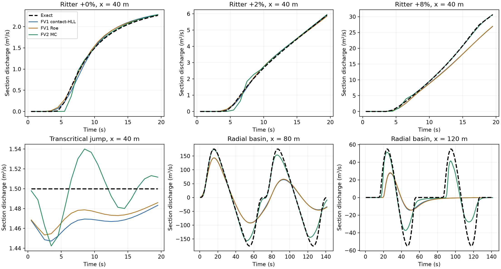

# Independent analytical flow comparisons

These 220 GPU runs span eleven analytical flow regimes, four grid spacings and five matched schemes. They measure discharge through physical cross-sections, including peak attenuation, flow reversal and wetting. Depth, velocity, momentum, minimum depth and mass residuals are retained for every run. The benchmark equations and physical parameters are independent of the solver.

**Accelerating dam breaks.** Set the bed to z = −Sx and let a = gS. Transform the flat-bed Ritter solution with x′ = x − at²/2 and u = u′ + at. Mass and inertial acceleration then satisfy the sloping-bed equations exactly. The three sections at 0, 40 and 80 m measure cumulative downstream storage and its exact one-second differences. The reservoir starts at 2 m. The 20 s solutions include horizontal, 2% and 8% downhill, and 2% uphill beds. Upstream and downstream model walls are 800 m from the initial front. The comparison window and sections are outside their physical domains of influence. An independent time integral of pointwise hu at each section checks the exact transport.

**Flow over a crest.** Four steady solutions conserve unit-width discharge q = 1.5 m²/s and total head z + h + q²/(2gh²) along each smooth branch. A raised cosine-squared bump is 0.4 m high and 120 m wide. The subcritical and supercritical cases use opposite Bernoulli roots. The transcritical solution changes branch at the critical crest. The fourth case includes a stationary hydraulic jump at x = 22.5 m on the downstream slope. Its conjugate depths carry equal mass and normal momentum flux and dissipate energy. Quadrature splits cells at the crest, bump limits and jump. These are exact-state preservation tests over 20 s in the interior, with remote walls outside the sampled characteristics. They do not measure the time to establish a steady flow from rest. The SWASHES collection describes this solution family. [Delestre et al.](https://doi.org/10.1002/fld.3741)

**Rain-fed slopes with Manning friction.** The exact profiles prescribe constant depth, spatial rainfall R(x), roughness n(x) and q′ = R. With vertical rainfall carrying zero horizontal momentum, the required bed gradient is z′ = −2Rq/(gh²) − n²q²/h^(10/3). All input cell averages are polynomial integrals. Rain increases from 36 to 108 mm/h and n from 0.025 to 0.040 across the domain. The 30 mm film crosses critical flow. The 150 mm case stays subcritical. The initial state is the exact moving equilibrium. The sampled 40 s interval tests transport and friction under sustained rainfall. This forcing differs from the Orton design event.

**Unsteady full 2D discharge.** A frictionless paraboloid of water expands and contracts over bed z = αr². Its radius obeys R²(t) = A²cos²(ωt) + B²sin²(ωt), with ω² = 2gα, A = 80 m and B = 160 m. Within the moving shoreline h = αB²(A/R)²(1 − r²/R²) and (u,v) = (R′/R)(x,y). Substitution gives R″ + 2gαR = 2gαA²B²/R³. Integrating h over the half-plane beyond each section gives the exact interval transport. Independently integrating hu across the section and over time checks the reference. A second initial quadrature at twice the degree checks cell-averaging error. Both model axes reconstruct and transport water in this case.

## Unit-width discharge errors at 5 m

RMSE in m²/s, weighted equally across three fixed sections and all sampling intervals. Secant fluxes are differences of accepted, signed face-volume ledgers divided by section width and sample duration. All five runs at each resolution use the same timestep cap.

| Analytical case | FV1 contact | FV1 Roe | FV1 HLLC | FV2 minmod | FV2 MC |
|---|---|---|---|---|---|
| Ritter +0% | 0.13509 | 0.081727 | 0.15861 | 0.13536 | 0.077494 |
| Ritter +2% | 0.15722 | 0.10394 | 0.18151 | 0.15113 | 0.13027 |
| Ritter +8% | 1.8737 | 1.8744 | 1.876 | 0.23043 | 0.21067 |
| Ritter -2% | 0.24796 | 0.21813 | 0.26017 | 0.15448 | 0.12673 |
| subcritical | 0.020402 | 0.020357 | 0.020402 | 0.0028575 | 0.0019339 |
| supercritical | 0.088446 | 0.088446 | 0.088446 | 0.013738 | 0.014926 |
| transcritical | 0.022003 | 0.022174 | 0.022003 | 0.0032125 | 0.0040936 |
| transcritical jump | 0.024471 | 0.021057 | 0.024472 | 0.0060613 | 0.019117 |
| thin transcritical | 0.0034163 | 0.0034163 | 0.0034163 | 2.2152e-05 | 2.2206e-05 |
| deep subcritical | 0.0021273 | 0.0020987 | 0.0021378 | 9.1494e-06 | 9.1673e-06 |

## Full 2D oscillating-basin discharge

Full-width discharges at 5 m. Timing uses interval means over 64 intervals per cycle. The timing error is undefined when the model has no positive discharge in the second cycle. Peak attenuation records loss of wave amplitude. Two cycles are used for volume and waveform errors.

| Method | Section x (m) | Exact second-cycle peak (m³/s) | Model peak (m³/s) | Peak time error (s) | Hydrograph RMSE (m³/s) | Positive-transport volume error (m³) |
|---|---|---|---|---|---|---|
| fv1 | 40 | 223.78 | 84.696 | 7.7574 | 76.99 | -2689 |
| fv1 | 80 | 175.3 | 64.521 | 5.541 | 64.404 | -2332.4 |
| fv1 | 120 | 54.971 | -0.127 | No outward peak | 25.016 | -1014.4 |
| roe | 40 | 223.78 | 85.818 | 8.8656 | 76.533 | -2652 |
| roe | 80 | 175.3 | 66.165 | 5.541 | 64.203 | -2270.2 |
| roe | 120 | 54.971 | -0.08818 | No outward peak | 25.094 | -1004 |
| hllc | 40 | 223.78 | 84.572 | 7.7574 | 76.906 | -2695.1 |
| hllc | 80 | 175.3 | 64.222 | 5.541 | 64.305 | -2346.2 |
| hllc | 120 | 54.971 | -0.12942 | No outward peak | 24.994 | -1018.6 |
| minmod | 40 | 223.78 | 184.4 | 1.1082 | 16.437 | -366.11 |
| minmod | 80 | 175.3 | 151.28 | -1.1082 | 14.383 | -373.7 |
| minmod | 120 | 54.971 | 38.595 | 1.1082 | 11.366 | -423.75 |
| mc | 40 | 223.78 | 186.12 | 0 | 15.619 | -349.99 |
| mc | 80 | 175.3 | 153.9 | -1.1082 | 13.645 | -355.51 |
| mc | 120 | 54.971 | 41.567 | 0 | 10.66 | -388.56 |

## Does discharge converge under grid refinement?

Three-section discharge RMSE in m²/s and consecutive observed orders. Moving fronts and shocks can give nonmonotone errors. The JSON includes each gauge separately.

| Case | Method | 20 m | 10 m | 5 m | 2.5 m | p₁ | p₂ | p₃ |
|---|---|---|---|---|---|---|---|---|
| Ritter +0% | fv1 | 0.30017 | 0.19714 | 0.13509 | 0.094095 | 0.60659 | 0.54526 | 0.52174 |
| Ritter +0% | mc | 0.21707 | 0.14333 | 0.077494 | 0.040048 | 0.59884 | 0.88715 | 0.95235 |
| Ritter +2% | fv1 | 0.49301 | 0.25617 | 0.15722 | 0.10868 | 0.9445 | 0.70433 | 0.53263 |
| Ritter +2% | mc | 0.39096 | 0.23972 | 0.13027 | 0.064284 | 0.70566 | 0.8799 | 1.0189 |
| Ritter +8% | fv1 | 7.0293 | 3.6079 | 1.8737 | 0.97437 | 0.96221 | 0.94525 | 0.94337 |
| Ritter +8% | mc | 0.63845 | 0.38196 | 0.21067 | 0.096952 | 0.74113 | 0.85847 | 1.1196 |
| Ritter -2% | fv1 | 0.4249 | 0.35651 | 0.24796 | 0.16935 | 0.25318 | 0.52384 | 0.55006 |
| Ritter -2% | mc | 0.34102 | 0.21991 | 0.12673 | 0.061841 | 0.63293 | 0.79519 | 1.0351 |
| subcritical | fv1 | 0.05853 | 0.036394 | 0.020402 | 0.010876 | 0.6855 | 0.83498 | 0.9075 |
| subcritical | mc | 0.024562 | 0.0077424 | 0.0019339 | 0.00048113 | 1.6656 | 2.0013 | 2.0071 |
| supercritical | fv1 | 0.25484 | 0.15923 | 0.088446 | 0.046759 | 0.67848 | 0.84822 | 0.91956 |
| supercritical | mc | 0.17211 | 0.059036 | 0.014926 | 0.0038747 | 1.5437 | 1.9838 | 1.9456 |
| transcritical | fv1 | 0.051072 | 0.035572 | 0.022003 | 0.012305 | 0.52178 | 0.69305 | 0.83845 |
| transcritical | mc | 0.041818 | 0.010136 | 0.0040936 | 0.0018556 | 2.0446 | 1.3081 | 1.1415 |
| transcritical jump | fv1 | 0.074536 | 0.04406 | 0.024471 | 0.013219 | 0.75847 | 0.84839 | 0.88842 |
| transcritical jump | mc | 0.031319 | 0.020607 | 0.019117 | 0.043909 | 0.60387 | 0.10827 | -1.1996 |
| thin transcritical | fv1 | 0.0040819 | 0.0038178 | 0.0034163 | 0.0028376 | 0.09649 | 0.16031 | 0.26775 |
| thin transcritical | mc | 0.00035208 | 8.6363e-05 | 2.2206e-05 | 5.6765e-06 | 2.0274 | 1.9595 | 1.9679 |
| deep subcritical | fv1 | 0.008594 | 0.0042685 | 0.0021273 | 0.0010618 | 1.0096 | 1.0047 | 1.0025 |
| deep subcritical | mc | 0.00014487 | 3.6519e-05 | 9.1673e-06 | 2.2967e-06 | 1.988 | 1.9941 | 1.9969 |

The catchment receives rainfall, exchanges water with soil and drains through survey-dependent openings. These controlled discharges test mechanisms. The Orton peak needs its own convergence or observational evidence.
