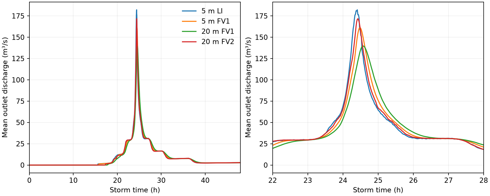
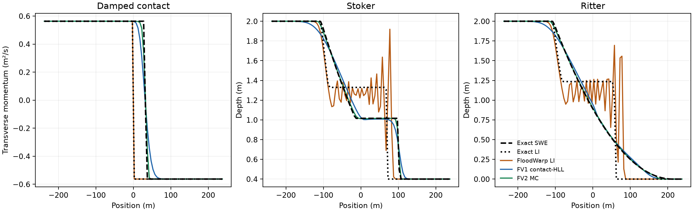
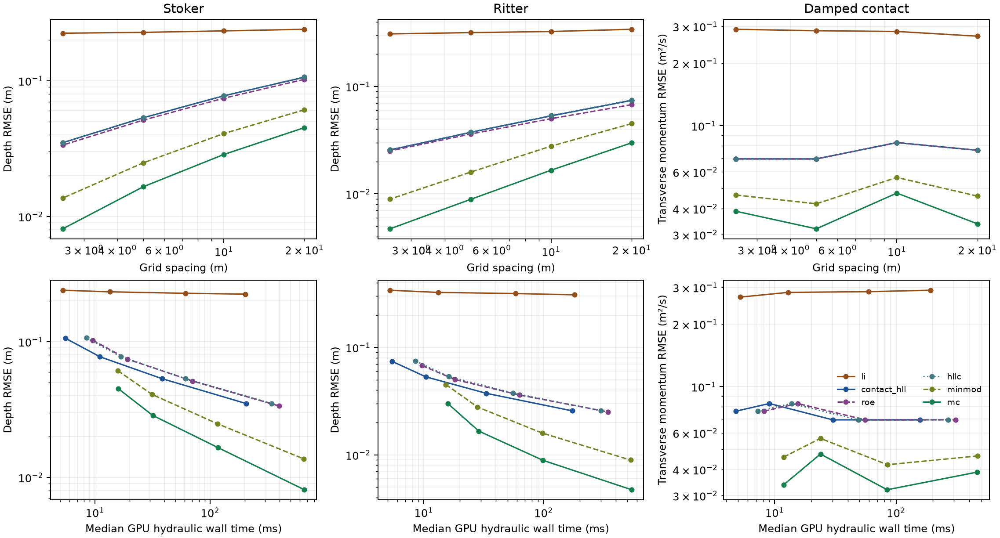

# Does FloodWarp FV2 respond like FloodWarp local inertia?

**The archived outlet hydrographs resemble each other. The momentum-transport tests distinguish the solvers.** FloodWarp LI at 5 m peaked one minute before corrected 20 m FV2. The full-event hydrograph RMSE is smaller against 5 m LI than against either FV1 control. Spatial agreement depends on the quantity. At hour 48, maximum-depth-envelope RMSE from FV2 was 0.278 m for 5 m LI, 0.113 m for 5 m FV1 and 0.035 m for 20 m FV1, on the original 5 m active footprint. The 20 m and 5 m models represent different channels, masks and coastal openings. These archived simulations provide no observed outlet or native-grid reference.

## Archived Orton outlet response over 48 hours

Existing 5 m FloodWarp LI and FV1 records have identical physical input signatures. All four complete records use the 578-node HIRDS storm. Metrics use one-minute gross outward volume differences. Only the 20 m corrected FV2 event completed. No matching 20 m LI event was established.

| Method | Peak (m³/s) | Peak time | Export (m³) | RMSE from 20 m FV2 (m³/s) | Correlation with 20 m FV2 |
|---|---|---|---|---|---|
| 5 m LI | 182.17 | 24 h 25 min | 1.6458e+06 | 1.7556 | 0.99612 |
| 5 m FV1 | 161.17 | 24 h 30 min | 1.6456e+06 | 2.2257 | 0.99334 |
| 20 m FV1 | 139.73 | 24 h 35 min | 1.6112e+06 | 4.666 | 0.97025 |
| 20 m FV2 | 171.72 | 24 h 26 min | 1.6184e+06 | 0 | 1 |

## Which tests separate the two momentum equations?

The comparison runs FloodWarp's public coarse-geometry LI solver with its resolved `physical_candidate` profile. FV1 and FV2 retain the divergence of the advective momentum flux. LI evolves the surface pressure gradient, local acceleration and Manning drag with staggered face discharge. The runs use FP64 on the same hardware, g = 9.80665 m/s², common 0.1 mm dry depth, the same physical domain and inputs, and reflecting outer boundaries. Errors are sampled in the interior half of each dimension, clear of the physical boundary waves. All 312 numerical configurations produced nonnegative final depths. For discharge errors in smooth shared solutions the actual face transport is used directly.

* **Positive-friction shear contact** isolates the omitted term with different exact predictions for the two equations. Start at constant h with u uniform and v switching between opposite values of equal magnitude. Both components decay by D = 1 + kt, k = gn²|u₀,v₀|/h^(4/3). SWE advects the contact to x = u₀ log(D)/k. The LI contact remains at its initial location. At 5 m after 24 s, exact SWE gives 32.22 m, FV2 MC gives 32.62 m, FV1 contact gives 31.46 m and FloodWarp LI gives −0.0004 m. LI's transverse-momentum RMSE against its own solution was 0.000033 m²/s. Against SWE it was 0.286 m²/s.
* **A partially dry lake and an accelerating uniform Manning plane** test the equations where both have the same exact solution. On the plane u = U tanh(gSt/U), U = h^(2/3)√S/n. The cumulative transport is the exact integral of hu. The lake tests equilibrium and conservation without advection.
* **Rain-fed slopes at 30 and 150 mm depth** test moving water with spatial rain, positive Manning friction and nonuniform momentum. The full-SWE reference comes from prescribing h and solving the exact steady momentum balance for z. The reduced momentum equation omits the gradient of q²/h, so the SWE target quantifies the combined effect of that approximation and LI discretisation.
* **Weak, Stoker and Ritter dam breaks** compare LI against both exact Riemann solutions. For flat inviscid LI the conservative flux is (q, gh²/2). Its left rarefaction gives q★ = 2√g(hL^(3/2) − h★^(3/2))/3. Its right shock gives q★ = (h★ − hR)√[g(h★ + hR)/2]. Their intersection sets h★, including for a dry downstream bed. Both models use analytical cell averages split exactly at waves. FloodWarp LI requires positive roughness. Every method runs with identical small positive roughness at two values, and the table below quantifies sensitivity to this inviscid limit. The dam-break references have zero friction. [Cozzolino et al., reduced-system Riemann solutions](https://doi.org/10.1016/j.advwatres.2019.103422) · [Delestre et al., analytical shallow-water benchmarks](https://doi.org/10.1002/fld.3741)

## Accuracy against full-momentum analytical solutions at 5 m

Transport is the absolute error in cumulative signed discharge per unit width over 24 seconds at x = 0. LI cell-centred momenta are averages of the neighbouring staggered discharges. Primary measurements use a common maximum timestep of Δx/64 and near-inviscid n = 10⁻⁷ where needed.

| Case | Measure | LI | FV1 contact | FV1 Roe | FV1 HLLC | FV2 minmod | FV2 MC |
|---|---|---|---|---|---|---|---|
| lake | h RMSE (m) | 0 | 0 | 0 | 0 | 0 | 0 |
| accelerating_plane | transport error (m²) | 0.0082697 | 0.20478 | 0.20345 | 0.20538 | 1.5361e-06 | 1.5361e-06 |
| thin_rain | transport error (m²) | 0.00043589 | 0.03861 | 0.03861 | 0.03861 | 0.0017963 | 0.0017984 |
| deep_rain | transport error (m²) | 0.0018246 | 0.043254 | 0.04284 | 0.04341 | 0.00023539 | 0.00023602 |
| weak_dam | h RMSE (m) | 0.0023728 | 0.0030667 | 0.0030637 | 0.0030668 | 0.0019553 | 0.0015347 |
| stoker | h RMSE (m) | 0.22727 | 0.053383 | 0.051277 | 0.053445 | 0.024835 | 0.016554 |
| ritter | h RMSE (m) | 0.31769 | 0.037393 | 0.036083 | 0.037569 | 0.015938 | 0.0088821 |
| damped_contact | hv RMSE (m²/s) | 0.28605 | 0.069269 | 0.069276 | 0.069269 | 0.042181 | 0.031983 |

## Does FloodWarp LI converge to the exact local-inertia dam break?

Entries are LI depth RMSE in metres. Distinct full-SWE and reduced-system solutions use the same left/right depths. At strong shocks LI also has substantial numerical error against its own exact solution on these grids. Four grids do not establish convergence there.

| Case | Reference PDE | 20 m | 10 m | 5 m | 2.5 m |
|---|---|---|---|---|---|
| weak_dam | swe | 0.0034148 | 0.0027561 | 0.0023728 | 0.0019627 |
| weak_dam | li | 0.0034071 | 0.0027391 | 0.0023736 | 0.0019312 |
| stoker | swe | 0.23934 | 0.23306 | 0.22727 | 0.22406 |
| stoker | li | 0.16345 | 0.18981 | 0.2092 | 0.19518 |
| ritter | swe | 0.34102 | 0.32546 | 0.31769 | 0.30919 |
| ritter | li | 0.2768 | 0.32564 | 0.26764 | 0.27286 |

## Measured error within the 5 m contact-HLL runtime budget

Five warmed synchronised wall times on one RTX 4070 Ti SUPER. Each times the same 24 s hydraulic simulation. Costs include work performed by the public run call and exclude setup, reference evaluation and retrieving diagnostic fields. Selection uses the measured grids only. The JSON separately gives device-loop times, graph capture, timesteps and full wall-time replicates for every method.

| Case | Measure | 5 m FV1 error | 5 m FV1 (ms) | Best affordable FV2 MC grid (m) | FV2 error | FV2 (ms) | 5 m FV2/FV1 cost |
|---|---|---|---|---|---|---|---|
| accelerating_plane | transport error (m²) | 0.20478 | 34.641 | 10 | 6.1015e-06 | 28.086 | 2.9433 |
| thin_rain | transport error (m²) | 0.03861 | 34.557 | 10 | 0.007055 | 28.865 | 3.0397 |
| deep_rain | transport error (m²) | 0.043254 | 34.786 | 10 | 0.00093904 | 28.686 | 2.9445 |
| weak_dam | h RMSE (m) | 0.0030667 | 38.226 | 10 | 0.0015257 | 31.753 | 3.0668 |
| stoker | h RMSE (m) | 0.053383 | 38.184 | 10 | 0.028613 | 31.749 | 3.0715 |
| ritter | h RMSE (m) | 0.037393 | 33.218 | 10 | 0.016615 | 28.816 | 2.9746 |
| damped_contact | hv RMSE (m²/s) | 0.069269 | 30.154 | 20 | 0.033806 | 11.87 | 2.7982 |

## Timestep and friction sensitivity at 5 m

Signed changes in the scalar errors above. Friction sensitivity applies only to the three inviscid-limit Riemann problems. The independent positive-friction tests require no such extrapolation.

| Case | Method | Measure | Primary error | Change with half dt | Change with n = 10⁻⁵ |
|---|---|---|---|---|---|
| lake | li | h RMSE (m) | 0 | 0 | — |
| lake | contact_hll | h RMSE (m) | 0 | 0 | — |
| lake | roe | h RMSE (m) | 0 | 0 | — |
| lake | hllc | h RMSE (m) | 0 | 0 | — |
| lake | minmod | h RMSE (m) | 0 | 0 | — |
| lake | mc | h RMSE (m) | 0 | 0 | — |
| accelerating_plane | li | transport error (m²) | 0.0082697 | -0.0041348 | — |
| accelerating_plane | contact_hll | transport error (m²) | 0.20478 | 0.0045021 | — |
| accelerating_plane | roe | transport error (m²) | 0.20345 | 0.0045021 | — |
| accelerating_plane | hllc | transport error (m²) | 0.20538 | 0.004502 | — |
| accelerating_plane | minmod | transport error (m²) | 1.5361e-06 | -1.1519e-06 | — |
| accelerating_plane | mc | transport error (m²) | 1.5361e-06 | -1.1519e-06 | — |
| thin_rain | li | transport error (m²) | 0.00043589 | -1.1229e-05 | — |
| thin_rain | contact_hll | transport error (m²) | 0.03861 | 8.4719e-05 | — |
| thin_rain | roe | transport error (m²) | 0.03861 | 8.4719e-05 | — |
| thin_rain | hllc | transport error (m²) | 0.03861 | 8.4719e-05 | — |
| thin_rain | minmod | transport error (m²) | 0.0017963 | -2.6393e-05 | — |
| thin_rain | mc | transport error (m²) | 0.0017984 | -2.6402e-05 | — |
| deep_rain | li | transport error (m²) | 0.0018246 | -5.9548e-06 | — |
| deep_rain | contact_hll | transport error (m²) | 0.043254 | 0.00025661 | — |
| deep_rain | roe | transport error (m²) | 0.04284 | 0.00025659 | — |
| deep_rain | hllc | transport error (m²) | 0.04341 | 0.00025658 | — |
| deep_rain | minmod | transport error (m²) | 0.00023539 | -8.2793e-07 | — |
| deep_rain | mc | transport error (m²) | 0.00023602 | -8.2795e-07 | — |
| weak_dam | li | h RMSE (m) | 0.0023728 | 6.1759e-06 | -2.8687e-12 |
| weak_dam | contact_hll | h RMSE (m) | 0.0030667 | 2.3991e-05 | 1.5448e-12 |
| weak_dam | roe | h RMSE (m) | 0.0030637 | 2.4088e-05 | 1.5462e-12 |
| weak_dam | hllc | h RMSE (m) | 0.0030668 | 2.3985e-05 | 1.5447e-12 |
| weak_dam | minmod | h RMSE (m) | 0.0019553 | -4.821e-07 | 1.6925e-12 |
| weak_dam | mc | h RMSE (m) | 0.0015347 | -4.3521e-07 | 1.3457e-12 |
| stoker | li | h RMSE (m) | 0.22727 | -0.00012059 | -3.4494e-09 |
| stoker | contact_hll | h RMSE (m) | 0.053383 | 0.00082561 | 9.628e-10 |
| stoker | roe | h RMSE (m) | 0.051277 | 0.00091469 | 4.7552e-10 |
| stoker | hllc | h RMSE (m) | 0.053445 | 0.00082316 | 9.7903e-10 |
| stoker | minmod | h RMSE (m) | 0.024835 | -2.1787e-05 | 1.1737e-10 |
| stoker | mc | h RMSE (m) | 0.016554 | -4.037e-05 | -4.3229e-10 |
| ritter | li | h RMSE (m) | 0.31769 | -0.00039531 | -8.7172e-09 |
| ritter | contact_hll | h RMSE (m) | 0.037393 | 0.00028233 | 2.583e-08 |
| ritter | roe | h RMSE (m) | 0.036083 | 0.0003429 | 2.5213e-08 |
| ritter | hllc | h RMSE (m) | 0.037569 | 0.00029052 | 2.6097e-08 |
| ritter | minmod | h RMSE (m) | 0.015938 | -1.9173e-05 | 9.7751e-08 |
| ritter | mc | h RMSE (m) | 0.0088821 | -9.2104e-05 | 2.7228e-07 |
| damped_contact | li | hv RMSE (m²/s) | 0.28605 | -1.2669e-08 | — |
| damped_contact | contact_hll | hv RMSE (m²/s) | 0.069269 | 0.00028675 | — |
| damped_contact | roe | hv RMSE (m²/s) | 0.069276 | 0.00028667 | — |
| damped_contact | hllc | hv RMSE (m²/s) | 0.069269 | 0.00028675 | — |
| damped_contact | minmod | hv RMSE (m²/s) | 0.042181 | -2.2231e-06 | — |
| damped_contact | mc | hv RMSE (m²/s) | 0.031983 | -2.59e-06 | — |
