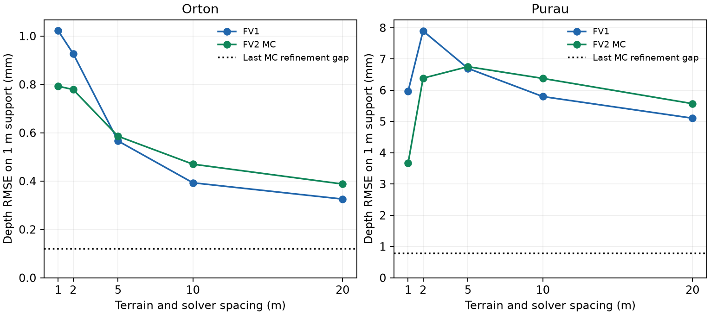
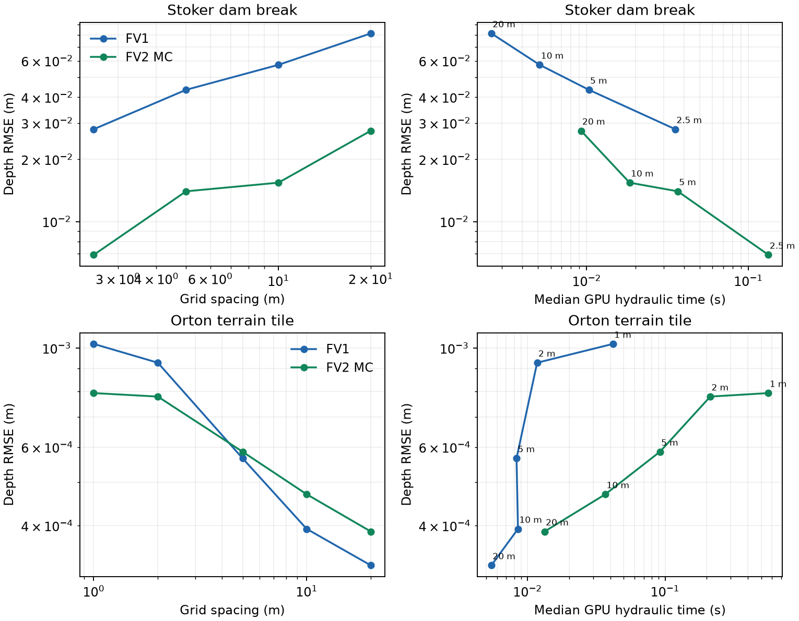
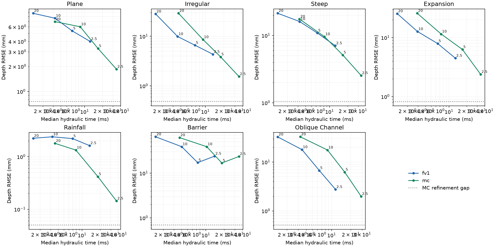

# FV2 shallow-water verification and hydraulic assessment

**Retain FV1 contact-HLL as the production default.** The experimental FV2 solver demonstrably reduces truncation error on smooth two-dimensional waves, dam breaks and oscillating shorelines. Its additional GPU work pays for itself on the Stoker benchmark. A catchment decision also depends on how well the grid represents topography, where the algorithm reverts to first order, and how well the reference itself has converged. The storm hydrographs are simulated design-event responses. No observed gauge record accompanies this HIRDS storm.

## Experiment and configuration

Branch `feature/fv2-muscl-rk2` starts at dev `8f15ad7`, which contains the corrected FV1 Roe/HLLC investigation. The FV1 and FV2 comparisons use the same FP64 contact-HLL flux except for the runs explicitly labelled Roe or HLLC. The full 48-hour Orton Bradley experiment also preserves the archived stage-zero coastal boundary law, soil parameters, spatial rainfall pattern and forcing nodes. The 200 m terrain tiles have their own boundary conditions and cannot reproduce the whole-catchment outlet. [FV1 architecture audit](ARCHITECTURE.md) · [FV1 numerical evidence](../fv1_riemann_review/REPORT.md) · [Measured tables](TABLES.md)

### Space discretisation

The conservative state is the cell average of depth and the two components of unit-width discharge. Independently along each axis, limit increments in free surface η, bed z and velocity components. Form free-surface differences as differences in depth plus differences in bed to retain precision at large elevation datums. Minmod retains the smaller like-signed one-sided difference. MC limits the centred difference by twice either one-sided difference. Opposite signs give zero slope.

Write Δh = Δη − Δz. Face depths are h± = h ± Δh/2. The momentum traces in each component are $m^\pm=h^\pm u \pm (h^- h^+/(2h))\Delta u$. Their arithmetic mean equals the cell momentum. Limiting velocity avoids dividing an independently reconstructed, potentially large momentum by a tiny reconstructed depth. In 40,000 seeded wet stencils with constant velocity, depths from 0.101 mm to 0.2 m and variable bed, the maximum velocity-trace error was 8.9 × 10⁻¹⁶ m/s. With the same depth traces and an independently MC-limited momentum slope, the 99th percentile error exceeded 8 m/s on both sides. This is a test of constant-velocity preservation.

The hydrostatic cut exposes water only above the higher of the two reconstructed beds. Momentum scales with the exposed depth. Both neighbours use the same conservative face flux. For each cell's normal momentum, difference the face flux less that side's exposed hydrostatic pressure; also subtract g h Δη/Δx (or Δy). The pressure corrections and centred surface term cancel the flux pressure gradient at constant surface. Reflecting, one-way FREE and prescribed-stage ghosts operate on the reconstructed interior state. The bed treatment targets lake equilibrium. A steep, underresolved bed step can obstruct moving water, and general Bernoulli equilibria have no exact-preservation guarantee. [Hydrostatic reconstruction](https://perso.math.u-pem.fr/bouchut.francois/publications/hydroproj_published.pdf) · [Second-order extension](https://www.sciencedirect.com/science/article/abs/pii/S0021999104005157)

### Time, sources and positivity

After a half-step water exchange and a half-step exact fixed-depth Manning drag, apply the two-stage SSP-RK2 transport operator. Stage one advances the conserved state by Δt L(U). Stage two reconstructs the new state and evaluates fresh face fluxes, then averages the original state and the second Euler result. A half-step drag and a half-step water exchange complete the symmetric composition. The bed term participates in both transport stages. An independent NumPy implementation uses array differences and reflecting ghost faces. Tests exercise both limiters on CPU and CUDA and compare the evolved soil history and all three conserved components. [NumPy reference](../../src/floodwarp/fv2_reference.py) · [SSP time integration](https://doi.org/10.1137/S003614450036757X)

Rain uses the exact mean rate of each half of a piecewise-linear forcing interval, including the spatial multiplier. The device timestep terminates at rainfall and boundary-stage knots. For constant-capacity plus exponential infiltration, the instantaneous capacity is I₀ + K + (f₀ − K) exp(−F/fd). Explicit midpoint advances cumulative infiltrated depth F and caps withdrawal by actual available surface water. Vertical rainfall adds zero horizontal momentum. Withdrawal integrates dm/dt = −I m/h for interval-mean rates, with zero momentum after complete exhaustion. For frozen h and n the exact drag update divides both momenta by 1 + Δt g n² |m|/h^(7/3). A switch in infiltration regime or at the dry threshold can locally reduce order.

A dry or missing neighbour or a nonpositive candidate face depth locally flattens the directional reconstruction. Each Euler stage scales all three flux components on the donor side if summed outgoing water would exhaust the cell. A roundoff margin of 2 × 10⁻¹⁵ applies only at exhaustion. Nonnegative thin water remains in storage. Momentum below the inherited dry threshold is zeroed. A negative depth or nonfinite conservative stage raises an error. Both reconstructed Riemann stages constrain the step to at most CFL Δaxis/(2 max|S|) at every face, including stage boundaries. A failed CFL trial retries on device before committing any physical state or accounting. Accepted hydrographs use half of each stage's limited face transport. Gross inflow and gross outflow are integrated separately. Maxima update once per accepted physical step.

### Software and GPU execution

Select `solver_method='fv2'` with `limiter='mc'` or `'minmod'`. FV2 rejects unsupported culverts, subgrid geometry and alternate Riemann solvers. Checkpoints record the reconstruction, limiter, time integrator, time-dependent boundary forcing and CFL predictor. Scratch stages are rebuilt on restart. Conditional CUDA graphs keep trial, acceptance and timestep selection on the GPU. The ordinary production loop performs no NumPy calculations or host readback within the CUDA graph. Reconstruction diagnostics are opt-in. Sparse execution builds sorted lists of active cells and their adjacent faces once per mask. Both stages visit all active source cells, dry neighbours and prescribed-stage ghosts, preserving wetting pathways. Empty internal faces can skip flux arithmetic. A dynamic wet-tile scheduler spanning both stages remains outstanding. [Input interface](../../docs/INPUTS.md) · [Regression tests](../../tests/test_fv2.py)

## Analytical verification

The 2D manufactured state uses a product of sin⁴ profiles in x and y, with independent periodic coefficients for depth and both momenta. Analytic space/time derivatives supply the forcing and analytic cell averages supply the initial state and final comparison. At fixed Δt = 0.00048828125 s the final refinement from 64² to 128² cells gave orders **2.27, 2.26 and 2.33** for h, hu and hv. Halving the timestep at the finest grid changed the state by at most 0.37% of the measured spatial RMSE. At fixed 16² the finest timestep pair gave **1.99, 1.99 and 2.00** against a further 16× timestep refinement. A separate uniform-cell source problem with time-dependent rain, exponential infiltration and stiff Manning drag gave final orders 2.025–2.029 against an independent DOP853 solution. [Manufactured study](manufactured.json) · [Fixed-timestep refinement and phase study](additional.json) · [Physical-source study](equilibria.json)

| At 5 m | FV1 contact-HLL | FV2 minmod | FV2 MC |
|---|---:|---:|---:|
| Ritter depth RMSE (m) | 0.03220 | 0.01255 | 0.00681 |
| Stoker depth RMSE (m) | 0.04663 | 0.02076 | 0.01393 |
| Off-grid jump depth RMSE (m) | 0.04201 | 0.02461 | 0.02339 |
| Oblique jump depth RMSE (m) | 0.03177 | 0.01546 | 0.01099 |
| Smooth shear transverse momentum RMSE (m²/s) | 0.02654 | 0.00246 | 0.00072 |
| Thacker fitted phase lag over two periods (s) | 4.573 | 0.255 | 0.164 |
| Thacker fitted amplitude, exact 48 m | 40.30 | 47.17 | 47.37 |

The Ritter 1 cm front lagged 26.85 m with FV1 and 15.29 m with FV2 MC. Stoker's 10–90% shock thickness fell from 26.87 to 10.54 m against an exact cell-average width of 5.42 m. The moving shear step narrowed from 39.46 to 16.77 m. FV2 MC had a 1.07 mm Stoker depth overshoot and a 9.50 mm off-grid jump overshoot. The oblique jump's transverse momentum RMSE increased from 0.02646 to 0.02937 m²/s. These limitations matter when local velocities or shock extrema determine the output. The existing Roe benchmark retains an advantage for a grid-aligned stationary normal shock. The four-grid full-SWE shear experiment here advances both momenta and both coordinate directions. The separate earlier scalar MUSCL demonstration remains historical evidence. [Analytical data](analytical.json) · [SWASHES analytical benchmarks](https://arxiv.org/abs/1110.0288)

The discontinuous, intermittently dry lake remained stationary to roundoff, including at a 2,000,000 m datum with a masked island and a barrier. The 5 m MC lake depth RMSE was 1.73 × 10⁻¹⁸ m. Every analytical run had nonnegative reported minimum depth. The largest normalised water ledger residual across the 96 strip/lake runs was 3.42 × 10⁻¹⁵. Uniform and gradually varied Manning flows are also checked in an interior observation window. For the gradual flow at 5 m, MC depth and streamwise momentum RMSE were 4.74 × 10⁻⁸ m and 1.70 × 10⁻⁶ m²/s. [Wave positions, volume residuals and steady controls](TABLES.md)

## Terrain representation and reference uncertainty

Both methods receive identical terrain at each spacing. The synthetic study samples a fixed mathematical surface at cell centres. The real DEM coarsening averages active source elevations within each block. FV2 infers limited face-bed slopes from those data, which is part of its discretisation. Seven synthetic cases reuse the same mathematical terrain on six hydraulic grids from 20 to 0.625 m. A separate experiment holds each 5 m bed cell and physical input constant under subdivision to 2.5 and 1.25 m. This isolates transport error on the same represented geometry. Both FV1 and FV2 provide independent numerical discretisations, using the common contact-HLL building block. The finest MC case also runs with a halved timestep on the resampled continuous surface. Reference-grid and cross-formulation differences are practical uncertainty indicators, without a rigorous error bound. [Synthetic data](synthetic.json)

On fixed 5 m terrain, MC reduced expansion-case depth RMSE against the 1.25 m MC reference from 5.30 to 1.51 mm. The reduction persisted against the alternative 1.25 m FV1 reference. The irregular case changed from 4.75 to 5.37 mm and the rainfall case from 2.79 to 2.97 mm. Both changes were smaller than the corresponding last reference refinement differences. In the steep case, depth and export pointed in different directions. The 5 m MC envelope RMSE fell from 8.71 to 4.47 mm while its export difference rose from 37.2 to 43.0 m³. All seven cases include velocity, wet-area overlap, wet component count, sampled arrival and outlet metrics. [Fixed-terrain comparisons](TABLES.md)

Further refinement to 0.3125 m with the independent Roe/HLL formulation confirmed the fixed-terrain expansion result. FV1 and FV2 had depth RMSE of 5.35 and 1.66 mm against fine MC, and 4.82 and 1.10 mm against fine Roe/HLL. The finest formulations differed by 1.48 mm. On fixed irregular terrain, the corresponding pairs were 5.26 and 5.66 mm, and 4.42 and 5.80 mm. Those differences were smaller than the 1.57 mm inter-method reference spread. On the resampled oblique channel, switching the reference reversed the ranking. For the resampled narrow barrier, the last reference grid change was 11.97 mm and the two 5 m methods differed in RMSE by less than 0.45 mm. This case cannot resolve an accuracy ranking. The largest finest-grid MC timestep effect across all 14 reference experiments was 0.0344 mm. [Fine-reference table](SYNTHETIC_REFERENCES.md) · [All fine-reference error metrics](synthetic_reference.json)

The 200 × 200 m Orton and Purau tile controls independently vary represented DEM and hydraulic grid. The 240 s Orton installation forcing and the 600 s Purau rain-peak segment are numerical controls. Both have 1 m surveys. Subcells at 0.5, 0.25 and 0.125 m hold that 1 m terrain constant. Full-field comparison uses a common 1 m support. A second control solves the aggregated 5 and 10 m DEMs at 1 m hydraulic spacing, preserving the geometry removed by aggregation as an identifiable error source. The native-grid FV1-to-MC final-depth RMSE fell from 1.022 to 0.793 mm at Orton and 5.965 to 3.666 mm at Purau. At 5 m it rose from 0.566 to 0.585 mm and from 6.698 to 6.753 mm respectively. The corresponding final MC reference refinement gaps were 0.120 and 0.774 mm, and the finest cross-method spreads were 0.337 and 1.990 mm. Timestep halving changed finest depth by 0.0045 and 0.0340 mm respectively on finest support. These comparisons cannot rank the small 5 m changes. Fine-grid depth improvement alone also failed to predict wet-area overlap. [Orton control](orton_terrain.json) · [Purau control](purau_terrain.json)



## Efficiency and sparse coverage

Five synchronised warmed repeats on an NVIDIA RTX 4070 Ti SUPER with FP64 state isolate hydraulic runtime. The timed interval includes the ordinary graph launch, CFL and RK work. Preprocessing, file IO, compilation and graph capture are excluded. First module preload, graph capture, CUDA pool use, owned-array sizes, timestep distributions and uncaptured per-kernel measurements are reported separately. CUDA pool high-water is the process cumulative high-water and should be interpreted alongside the configuration's owned arrays. Timing on one GPU and these domains cannot be extrapolated as a constant performance factor. [Raw timings](cost.json)

| Stoker, adaptive timestep, dense | Depth RMSE (m) | Median hydraulic time (ms) | Steps | Device arrays (MB) |
|---|---:|---:|---:|---:|
| FV1 5 m | 0.04343 | 10.32 | 142 | 2.14 |
| FV2 MC 5 m | 0.01401 | 36.59 | 192 | 3.99 |
| FV2 MC 20 m | 0.02752 | 9.23 | 48 | 0.25 |
| FV1 2.5 m | 0.02799 | 35.30 | 284 | 8.54 |

At approximately the 5 m FV1 budget, the coarser FV2 Stoker depth RMSE was 37% lower. At 5 m the same-grid hydraulic cost was 3.54× FV1. The Orton 5 m installation tile took 8.31 ms with FV1 and 91.77 ms with MC, with 120 and 307 accepted steps respectively. The small wet-area tile has a different CFL history and kernel utilisation. Dense and sparse modes produced bitwise-identical final fields across all 18 case/grid/method pairs. A separate alternating dense/compact replay on the real footprint gave 20.84 versus 12.45 ms over 8 s at dry hour 1 and 701.38 versus 627.41 ms at wet hour 25 on the 5 m grid. The 6.73 MB index lists reduced wet-window time by 10.6% and dry-window time by 40.3%. State, accepted timesteps, face transport, maxima and ledgers matched bitwise at all three grid resolutions. [Scheduling study](scheduling.json) The higher-order stored state requires extra RK scratch, two directional slopes, per-stage fluxes and water-exchange amounts. After both face kernels finish, the second Euler update can overwrite its own input. An extra 24 bytes per cell is reserved only during reconstruction diagnostics, saving 568 MB on the full 1 m Orton grid in ordinary operation. [Execution table](TABLES.md)



At wet hour 25 on the full 5 m grid, CUDA events measured a median 1.690 ms of uncaptured kernel work per accepted FV1 step and 6.987 ms per FV2 step. FV1 face fluxes took 0.797 ms and its cell CFL reduction 0.118 ms. FV2 slope reconstruction took 1.024 ms, the two stages' four oriented face kernels 3.235 ms including face CFL, the two source half-steps 1.263 ms and both Euler updates 0.517 ms. Over a 12 s window FV1 also needed 88 accepted steps versus 161 for FV2. Separate stage evaluations and the more conservative unsplit step both contribute to wall cost. [Matched wet GPU profile](hirds48/wet_cost.json)

In a fresh Warp cache, shared FV1 kernel compilation and loading took 0.683 s and the FV2 module took a further 0.179 s. First graph capture in that cold process included Warp loading other registered modules and took 15.79 s. Reusing the captured graph had zero capture time. The device-array timings above are warm. [Cold cache evidence](compile.json)

The entire 1 m Orton footprint contains 23,667,225 raster cells (13,999,625 active). For a feasibility measurement, each 5 m parent at hour 25 distributed its water across the surveyed subcells at a common level, conserving its total water and both momenta. Three consecutive half-second wet intervals required 1.52 wall seconds per simulated second with FV1 and 10.18 with FV2. CUDA pool use was 6.15 and 11.46 GB respectively. Applying those rates uniformly to a 48 h event would imply roughly 73 and 489 GPU-hours. Wetness and timestep vary through the storm, so this is a scale estimate only. A full 48-hour domain-wide 1 m reference refined again at 0.5 and 0.25 m was beyond this single-GPU investigation. The full-domain native probe measures computational feasibility; its coarse-derived initial state precludes using its fields as flood truth. [Native GPU probe](whole_native_probe.json)

The replicated irregular synthetic case also favoured FV1 at its 5 m cost. FV1 used 6.80 ms for 6.61 mm final-depth RMSE against the 0.625 m MC reference. The 20 m MC run was the tested FV2 grid within that budget and had 29.12 mm RMSE. On the rainfall case the corresponding pair was 2.21 versus 1.80 mm, a difference requiring reference-uncertainty checks. The label beside each point in the figure gives grid spacing in metres. [Synthetic GPU timings and both references](synthetic_cost.json)



## Orton Bradley 48-hour scenario

The historical HIRDS v4 100-year design storm has **578 time nodes, 272.095646 mm mean depth and 3,809,237.012 m³ integrated rainfall**. Peak rain was 74.62 mm/h at 23 h 57 min 30 s. The runner validates both arrays' SHA-256 hashes and the integrated spatial volume. Every test starts dry with zero cumulative storm infiltration. The outlet is the sum of outward water crossing the prescribed-stage coastal boundary. Hydrographs have one-minute support. The original 5 m FV1 control uses its completed 48 h checkpoint and minute hydrograph. All other matrix entries integrate from storm time zero. The 10 and 20 m representations include any block touching the active mask. Mean-active bed and Manning fields, full-area rainfall/loss integrals, and projected coastal openings preserve input volume while recording footprint and boundary changes. The original 212 coastal contacts span 1,060 m; the projected 20 m openings span 1,120 m with mean displacement 13.10 m and maximum 40.70 m. The native production FV1 default flux is contact-HLL. These runs preserve the event archive's explicit stage-momentum setting. [Exact 578-node storm shape and cumulative volume](hirds48/hirds_forcing.csv) · [Storm driver](../fv2_orton_matrix.py) · [Data attribution and hydraulic assumptions](../../examples/orton_bradley/DATA_LICENSE.md)

The released 5 m ordinary input files and the independent hour-25 checkpoint generated bitwise-identical fields at all three storm spacings. The public data path runs the 5 m control from dry when the historical archive is unavailable. The regression for masked stage inflow verifies equality under translation between the exterior perimeter and an internal inactive-cell boundary. The lowest coastal bed exceeds the prescribed stage by 0.1594 m at 5 m and 0.19192 m at 10 and 20 m. The directional slope is zero next to an inactive cell, so the exterior coastal ghost is dry across the entire full-event matrix. [Public input parity](hirds48/public_input_parity.json)

On the coastal tile the 5 m FV1 and MC outlet peaks were 61.34 and 51.17 L/s. With the native 1 m terrain they were 29.24 and 28.93 L/s, both in the 15-minute interval ending at hour 26. Keeping FV1 and the 5 m DEM fixed while refining its hydraulic spacing to 1 m changed final depth by 1.36 mm RMSE. Switching the represented terrain at the same 1 m hydraulic spacing changed it by 72.92 mm. For 10 m terrain the two changes were 4.17 and 98.97 mm. For FV2, those hydraulic-grid and terrain changes were 4.04 and 72.88 mm at 5 m, and 11.84 and 98.78 mm at 10 m. These full-event comparisons use the same original 1 m active footprint and retain the 3,755.956 m³ spatial rainfall volume. They quantify the sensitivity of model predictions to the grid and terrain.

At 10 m the completed FV1 contact-HLL, Roe/HLL, HLLC/HLL and FV2 MC outlet peaks were 150.64, 150.25, 150.77 and 136.99 m³/s. All three FV1 peaks fell in the minute ending at 24 h 32 min. The FV2 peak arrived three minutes earlier. FV2 exported 42,010 m³ less than contact-HLL over 48 h, retained an extra 38,918 m³ and infiltrated an extra 3,092 m³. Relative to the 5 m contact-HLL model, maximum-depth RMSE was 0.0646 m for 10 m FV1 and 0.0844 m for 10 m FV2. The inundation IoU fell from 0.780 to 0.461 above 1 cm, from 0.667 to 0.395 above 10 cm, and from 0.664 to 0.498 above 30 cm. Disagreement extends beyond wet films. The same-grid FV1 flux choices were much closer to one another.

At 20 m, FV2 exported 82,498 m³ less than FV1 over the 48 h storm. Its extra final surface storage accounted for 80,785 m³ of that difference and extra infiltration for 1,714 m³. On the original 5 m active footprint, the 20 m FV1 and FV2 maximum-depth RMSE against 5 m FV1 was 0.115 and 0.141 m. Peak inundation overlap above 1 cm was 0.655 and 0.445 respectively. The wet FV2 peak replay after the masked-stage correction reproduced 66,116 steps and all checked arrays bitwise at 20 m.

The storm tables report the twelve full hydrographs, maximum depth and inundation on common active support, directional transport diagnostics, independent-model discharge comparisons and separate wet-window timings. The support used for each metric is given with the table. [Whole-domain results](hirds48/RESULTS.md) · [48-hour native-tile comparison and reference sensitivity](NATIVE_STORM.md) · [Fixed-terrain controls](storm_geometry.md)


The earlier 120 s wet continuations exercise full-domain state transfer and restart sensitivity. Their start times, terrain shapes and checkpoint hashes remain available. They are excluded from the design-storm hydrographs and practical rankings. [Orton continuation](orton_full_window.json) · [NZ demo continuation](nz_demo_full_window.json)

The separate Purau guided-DEM package specifies a 303.62 mm external 48 h hyetograph and an empty boundary list. Applying an invented full-catchment outlet or relabelling that forcing as the Orton HIRDS event would invalidate a matched comparison. The Purau terrain controls therefore state their cut-edge boundary assumptions and forcing window.

## Engineering decision

| Question | Finding |
|---|---|
| A. Smooth accuracy | All three conserved components approached order two under independent spatial and temporal refinement. Source histories also converged at order two in a wet, smooth physical-source control. |
| B. Stability | The tested steep, transcritical, drying and rewetting cases remained physically admissible. FV2 MC had small shock overshoots and does not preserve a moving equilibrium exactly. |
| C. Numerical diffusion | At 5 m the Stoker thickness fell by 61% and the discontinuous shear width by 58%. Over two Thacker periods the amplitude loss fell from 7.70 to 0.63 m. |
| D. Native predictions | Source-resolution tile depths can improve. Wet extent, export and timing do not show a uniform benefit. Whole-catchment observed flood accuracy remains undetermined. |
| E. Coarse versus native | At 5 and 10 m neither short real-terrain tile gave a resolved reduction in final-depth RMSE against the fine reference. Whole-domain storm results use a 5 m model comparator. |
| F. Relative to geometry loss | In the full 48-hour coastal tile, replacing the 5 m terrain at fixed hydraulic spacing changed final depths by about 73 mm RMSE for either solver. Refining the hydraulic grid on that fixed terrain changed them by 1.36 mm with FV1 and 4.04 mm with FV2. |
| G. Actual cost | Same-grid Stoker at 5 m cost 3.54× FV1 in the primary dense benchmark. The hour-25 full 5 m Orton wet replay cost about 7.2×. Sparse mask indexing recovers some time in both wet and dry windows. |
| H. Equal cost | Stoker favours coarser FV2 at about the 5 m FV1 budget. An equal-cost advantage across practical rainfall-driven catchments has not been established. |
| I. Production selection | Keep FV1 contact-HLL as default. Retain FV2 as an explicitly selected experimental solver, particularly for wave-dominated applications. |

## Regression results

The complete FP64 suite with CUDA SWE, the adapted external reference executable and the offscreen renderer enabled passed **1,791 tests**, with 24 skips and 743 warnings in 352.60 s. Eighteen skips cover unsupported graph/trace combinations, four require the mixed-precision configuration, and two require the separately installed external CPU model or its smoke runner. All four mixed-precision cases passed in a separate run. The FV2 validation, including the native GPU solver, uses FP64.

## Reproduce

Use the pinned Python 3.14 environment with the project test and plotting extras. Run modules from the repository root. The local catchment archive paths are set in each module's main guard. For a fresh full-event run, extract the public data archive at the configured release directory. The 1 m site studies also need the locally identified native terrain. [Release input instructions](../../examples/orton_bradley/README.md) The machine-readable evidence lists the input identities. See the numerics tables for the full set of error metrics and refinement outcomes.

```sh
OVERLANDER_TEST_FULL_SWE_CUDA=1 FLOODWARP_TEST_RENDER=1 FLOODWARP_REFERENCE_BINARY="$PWD/outputs/qualified_reference/build/lisflood" python -m pytest -q -rs
FLOODWARP_PRECISION=mixed python -m pytest -q tests/test_mixed_precision_conditioning.py tests/test_masked_free.py::test_masked_free_conditioned_mixed_precision_drains
python -m validation.fv2_accuracy
python -m validation.fv2_equilibria
python -m validation.fv2_additional
python -m validation.fv2_terrain
python -m validation.fv2_reference_check
python -m validation.fv2_synthetic_cost
python -m validation.fv2_native
python -m validation.fv2_compile
python -m validation.fv2_cost
python -m validation.fv2_scheduling
python -m validation.fv2_storm_cost
python -m validation.fv2_full_native_probe
python -m validation.fv2_figures
python -m validation.fv2_orton_matrix
python -m validation.fv2_native_storm
python -m validation.fv2_storm_geometry
python -m validation.fv2_native_storm_evidence
python -m validation.fv2_stage_replay
python -m validation.fv2_storm_evidence
python -m validation.fv2_storm_tables
python -m validation.fv2_verify_evidence
```

Patrick Durney / Lincoln Agritech Ltd. The implementation and verification scripts use the repository software licence. The real-terrain outputs derive from the separately credited elevation data. [Attribution](../../THIRD_PARTY_NOTICES.md)
