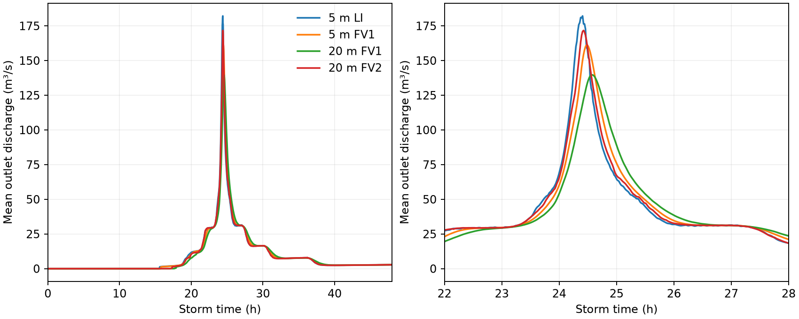
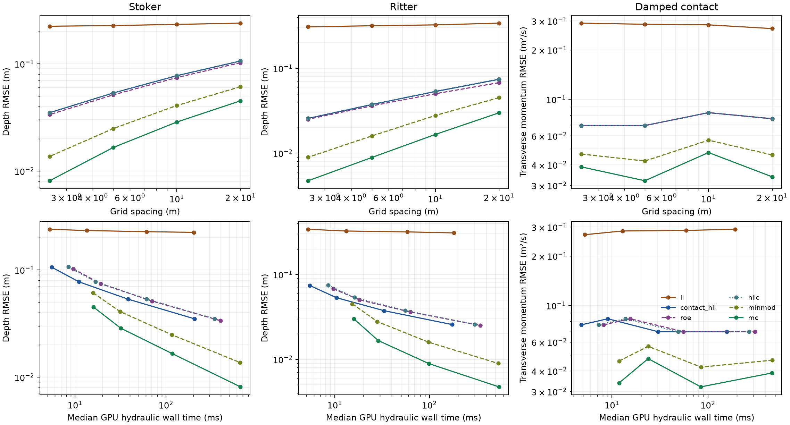

# FV2 shallow-water verification and hydraulic assessment

**Retain FV1 contact-HLL as the production default.** The corrected FV2 solver reduces numerical diffusion on wave benchmarks and demonstrates second-order convergence over flat and curved beds. Correcting a spurious uphill step changed the practical hydraulic comparison. Controlled GPU timings now cover the analytical flows. A catchment decision also depends on how well the grid represents topography, where the algorithm reverts to first order, and how well the reference itself has converged. The storm hydrographs are simulated design-event responses. No observed gauge record accompanies this HIRDS storm.

## Experiment and configuration

Branch `feature/fv2-muscl-rk2` starts at dev `8f15ad7`, which contains the corrected FV1 Roe/HLLC investigation. The FV1 and FV2 comparisons use the same FP64 contact-HLL flux except for the runs explicitly labelled Roe or HLLC. The full 48-hour Orton Bradley experiment also preserves the archived stage-zero coastal boundary law, soil parameters, spatial rainfall pattern and forcing nodes. The 200 m terrain tiles have their own boundary conditions and cannot reproduce the whole-catchment outlet. [FV1 architecture audit](ARCHITECTURE.md) · [FV1 numerical evidence](../fv1_riemann_review/REPORT.md) · [Analytical discharge tables](FLOW_TRUTH.md)

### Space discretisation

The conservative state is the cell average of depth and the two components of unit-width discharge. Independently along each axis, limit increments in free surface η, bed z and velocity components. Form free-surface differences as differences in depth plus differences in bed to retain precision at large elevation datums. Minmod retains the smaller like-signed one-sided difference. MC limits the centred difference by twice either one-sided difference. Opposite signs give zero slope.

Before calculating depth traces, bound each directional bed increment by the smaller absolute difference between the cell and its two neighbours. Where the MC bed increment exceeds this bound, scale its free-surface increment by the same ratio. For any adjacent pair with centre rise D, both directed bed increments now have the sign of D or are zero, and both magnitudes are at most |D|. The reconstructed rise D − (Δz_left + Δz_right)/2 has the sign of D or vanishes. A zero surface slope stays zero at a lake. Equal bed and surface increments stay equal for constant depth. On smooth monotone beds the adjustment to a cell increment is of order Δx². The curved-bed manufactured test below directly measures the resulting order.

Write Δh = Δη − Δz. Face depths are h± = h ± Δh/2. The momentum traces in each component are $m^\pm=h^\pm u \pm (h^- h^+/(2h))\Delta u$. Their arithmetic mean equals the cell momentum. Limiting velocity avoids dividing an independently reconstructed, potentially large momentum by a tiny reconstructed depth. In 40,000 seeded wet stencils with constant velocity, depths from 0.101 mm to 0.2 m and variable bed, the maximum velocity-trace error was 1.78 × 10⁻¹⁵ m/s. With the same depth traces and an independently MC-limited momentum slope, the 99th percentile error exceeded 4.09 m/s on both sides. This is a test of constant-velocity preservation.

The hydrostatic cut exposes water only above the higher of the two reconstructed beds. Momentum scales with the exposed depth. Both neighbours use the same conservative face flux. For each cell's normal momentum, difference the face flux less that side's exposed hydrostatic pressure; also subtract g h Δη/Δx (or Δy). The pressure corrections and centred surface term cancel the flux pressure gradient at constant surface. Reflecting, one-way FREE and prescribed-stage ghosts operate on the reconstructed interior state. The bed treatment targets lake equilibrium. A steep, underresolved bed step can obstruct moving water, and general Bernoulli equilibria have no exact-preservation guarantee. [Hydrostatic reconstruction](https://perso.math.u-pem.fr/bouchut.francois/publications/hydroproj_published.pdf) · [Second-order extension](https://www.sciencedirect.com/science/article/abs/pii/S0021999104005157)

### Time, sources and positivity

After a half-step water exchange and a half-step exact fixed-depth Manning drag, apply the two-stage SSP-RK2 transport operator. Stage one advances the conserved state by Δt L(U). Stage two reconstructs the new state and evaluates fresh face fluxes, then averages the original state and the second Euler result. A half-step drag and a half-step water exchange complete the symmetric composition. The bed term participates in both transport stages. An independent NumPy implementation uses array differences and reflecting ghost faces. Tests exercise both limiters on CPU and CUDA and compare the evolved soil history and all three conserved components. [NumPy reference](../../src/floodwarp/fv2_reference.py) · [SSP time integration](https://doi.org/10.1137/S003614450036757X)

Rain uses the exact mean rate of each half of a piecewise-linear forcing interval, including the spatial multiplier. The device timestep terminates at rainfall and boundary-stage knots. For constant-capacity plus exponential infiltration, the instantaneous capacity is I₀ + K + (f₀ − K) exp(−F/fd). Explicit midpoint advances cumulative infiltrated depth F and caps withdrawal by actual available surface water. Vertical rainfall adds zero horizontal momentum. Withdrawal integrates dm/dt = −I m/h for interval-mean rates, with zero momentum after complete exhaustion. For frozen h and n the exact drag update divides both momenta by 1 + Δt g n² |m|/h^(7/3). A switch in infiltration regime or at the dry threshold can locally reduce order.

A dry or missing neighbour or a nonpositive candidate face depth locally flattens the directional reconstruction. Each Euler stage scales all three flux components on the donor side if summed outgoing water would exhaust the cell. A roundoff margin of 2 × 10⁻¹⁵ applies only at exhaustion. Nonnegative thin water remains in storage. Momentum below the inherited dry threshold is zeroed. A negative depth or nonfinite conservative stage raises an error. Both reconstructed Riemann stages constrain the step to at most CFL Δaxis/(2 max|S|) at every face, including stage boundaries. A failed CFL trial retries on device before committing any physical state or accounting. Accepted hydrographs use half of each stage's limited face transport. Gross inflow and gross outflow are integrated separately. Maxima update once per accepted physical step.

### Software and GPU execution

Select `solver_method='fv2'` with `limiter='mc'` or `'minmod'`. FV2 rejects unsupported culverts, subgrid geometry and alternate Riemann solvers. Checkpoints record the reconstruction, limiter, time integrator, time-dependent boundary forcing and CFL predictor. Scratch stages are rebuilt on restart. Conditional CUDA graphs keep trial, acceptance and timestep selection on the GPU. The ordinary production loop performs no NumPy calculations or host readback within the CUDA graph. Reconstruction diagnostics are opt-in. Sparse execution builds sorted lists of active cells and their adjacent faces once per mask. Both stages visit all active source cells, dry neighbours and prescribed-stage ghosts, preserving wetting pathways. Empty internal faces can skip flux arithmetic. A dynamic wet-tile scheduler spanning both stages remains outstanding. [Input interface](../../docs/INPUTS.md) · [Regression tests](../../tests/test_fv2.py)

## Hydraulic failure that required correction

The previous MC implementation independently extrapolated the neighbouring bed slopes to each face. At 5 m Orton storm hour 24 the surveyed model bed descended from 339.557 to 335.040 m towards the east. The two extrapolated face beds instead rose from 336.062 to 338.192 m, completely blocking a downhill water column. Gravity continued accelerating the stored momentum until drag balanced it at 28.38 m/s. Depth and mass positivity alone missed this numerical failure. The same snapshot had 181,378 northward and 191,492 eastward interior bed-face reversals, with adverse jumps up to 3.665 m. The corrected slopes produced zero reversals over all 1,117,849 active interior faces. At the tagged cell both face elevations now equal 337.298 m. [Seven-cell stencil in both directions](orton_false_step_stencil.json) · [Independent flux and face-order audit](bed_face_audit.json)

In matched continuations from that physical state, the original method retained 0.782 m at 28.43 m/s after 60 s. The corrected method drained to 0.00708 m at 0.963 m/s. Rainfall, Manning roughness, infiltration, the physical mask and starting conservative fields were identical. This specific failure can be reproduced from the archived input. Existing FV1 results remain valid. Version-one experimental FV2 storm rankings are superseded. The corrected solver explicitly rejects version-one FV2 checkpoints. [Original continuation](bed_release_muscl_eta_bed_velocity_v1.json) · [Corrected continuation](bed_release_muscl_ordered_bed_velocity_v2.json) · [Historical investigation at 3121fed](https://github.com/Lincoln-Environmental/floodwarp/blob/3121fed/validation/fv2_review/REPORT.md)

## Analytical verification

The 2D manufactured state uses a product of sin⁴ profiles in x and y, with independent periodic coefficients for depth and both momenta. Analytic space/time derivatives supply the forcing and analytic cell averages supply the initial state and final comparison. At fixed Δt = 0.00048828125 s the final refinement from 64² to 128² cells gave orders **2.27, 2.26 and 2.33** for h, hu and hv. Halving the timestep at the finest grid changed the state by at most 0.37% of the measured spatial RMSE. At fixed 16² the finest timestep pair gave **1.99, 1.99 and 2.00** against a further 16× timestep refinement. For a curved bed z = 0.12 cos(2πx/L) cos(2πy/L) m, analytical bed cell averages and the prescribed +g h ∇z force yield the same exact time-dependent state. On that bed, the final fixed-step spatial refinement gave orders **2.03, 1.97, 1.97** and the fixed-grid temporal refinement gave **2.01, 1.99, 2.01**. Halving the finest spatial run's time step displaced each component by less than 0.045% of its spatial error. A separate uniform-cell source problem with time-dependent rain, exponential infiltration and stiff Manning drag gave final orders 2.025–2.029 against an independent DOP853 solution. [Manufactured study](manufactured.json) · [Fixed-timestep refinement and phase study](additional.json) · [Physical-source study](equilibria.json)

| At 5 m | FV1 contact-HLL | FV2 minmod | FV2 MC |
|---|---:|---:|---:|
| Ritter depth RMSE (m) | 0.03220 | 0.01255 | 0.00681 |
| Stoker depth RMSE (m) | 0.04663 | 0.02076 | 0.01393 |
| Off-grid jump depth RMSE (m) | 0.04201 | 0.02461 | 0.02339 |
| Oblique jump depth RMSE (m) | 0.03177 | 0.01546 | 0.01099 |
| Smooth shear transverse momentum RMSE (m²/s) | 0.02654 | 0.00246 | 0.00072 |
| Thacker fitted phase lag over two periods (s) | 4.573 | 0.255 | 0.247 |
| Thacker fitted amplitude, exact 48 m | 40.30 | 47.17 | 46.98 |

The Ritter 1 cm front lagged 26.85 m with FV1 and 15.29 m with FV2 MC. Stoker's 10–90% shock thickness fell from 26.87 to 10.54 m against an exact cell-average width of 5.42 m. The moving shear step narrowed from 39.46 to 16.77 m. FV2 MC had a 1.07 mm Stoker depth overshoot and a 9.50 mm off-grid jump overshoot. The oblique jump's transverse momentum RMSE increased from 0.02646 to 0.02937 m²/s. These limitations matter when local velocities or shock extrema determine the output. The existing Roe benchmark retains an advantage for a grid-aligned stationary normal shock. The four-grid full-SWE shear experiment here advances both momenta and both coordinate directions. The separate earlier scalar MUSCL demonstration remains historical evidence. [Analytical data](analytical.json) · [SWASHES analytical benchmarks](https://arxiv.org/abs/1110.0288)

The discontinuous, intermittently dry lake remained stationary to roundoff, including at a 2,000,000 m datum with a masked island and a barrier. The 5 m MC lake depth RMSE was 2.83 × 10⁻¹⁸ m. Every analytical run had nonnegative reported minimum depth. The largest normalised water ledger residual across the 96 strip/lake runs was 3.42 × 10⁻¹⁵. Uniform and gradually varied Manning flows are also checked in an interior observation window. For the gradual flow at 5 m, MC depth and streamwise momentum RMSE were 6.23 × 10⁻⁷ m and 2.82 × 10⁻⁷ m²/s. [Wave and volume data](analytical.json) · [Steady-flow data](equilibria.json)

## Synthetic terrain and representation error

All comparisons use identical physical input fields within each resolution. On the resampled synthetic domains, each grid samples the same analytical surface. Additional comparisons subdivide the 5 m input without adding geometric information. Diagnostics include cell-average depth and both discharge components, wet extent and connected components, wet-region velocity, arrival, and outlet volume, peak and timing. Two hydraulic formulations at 0.625 and 0.3125 m and a halved MC timestep quantify fine-reference sensitivity. The sensitivity is an uncertainty indicator for these comparisons. [Synthetic domain results](synthetic.json) · [Cross-formulation references](SYNTHETIC_REFERENCES.md)

The corrected synthetic matrix includes seven domains. At 5 m on the resampled irregular catchment, depth RMSE against the 0.3125 m MC reference fell from 6.62 mm with FV1 to 3.96 mm with FV2. Holding every 5 m terrain and forcing cell fixed under subdivision reversed that ordering, with errors of 5.26 and 5.75 mm. The finest inter-method difference in the fixed case was 1.57 mm. The 0.49 mm apparent disadvantage is below that sensitivity. [Independent grid and timestep controls](SYNTHETIC_REFERENCES.md)

## Orton Bradley and GPU cost

The complete scenario uses the archived HIRDS v4 100-year historical design storm with **578 original nodes**, **272.095646 mm** and **3,809,237.012 m³** of rainfall. Rain peaks at 74.62 mm/h at 23 h 57 min 30 s. Every case starts dry and preserves the full space-time rain integral. The original 5 m FV1 control uses its archived minute ledger and checkpoint, verified against the public release physical inputs. All four schemes use the existing stage-zero coastal ghost law and the same soil model. Coarser grids retain blocks with any active source cell, preserve the full-area rain and soil parameter integrals, and record mask and discharge boundary changes. The 20 m coast spans 1,120 m compared with 1,060 m at 5 m. No observed hydrograph accompanies this design storm. [Exact HIRDS forcing](hirds48/hirds_forcing.csv) · [Public input hashes and boundary geometry](hirds48/public_input_parity.json) · [Data credits](../../examples/orton_bradley/DATA_LICENSE.md)

At 5 m the complete FV1 outlet peaks were 161.173 m³/s for contact-HLL, 160.917 for Roe/HLL and 161.216 for HLLC/HLL. They differed by less than 216 m³ of export over 48 hours. At 20 m their peaks were 139.73, 139.08 and 139.94 m³/s respectively. For the minute ending at hour 24, HLL carried 34.66% of Roe's absolute discharge at 5 m despite accounting for 97.70% of faces. The 5 m adapted LISFLOOD-FP outlet peaked at 161.483 m³/s. These are inter-model comparisons.

The requested change of scope stopped the remaining Orton experiments. The completed whole-catchment evidence consists of nine FV1 events, the corrected 20 m FV2 event and the archived 5 m FloodWarp LI event. The corrected 10 m FV2 minute ledger reached hour 13, with an hour-12 restart. The corrected 5 m whole-catchment run did not start. The corrected coastal tile completed 48 hours at 20, 10, 5 and 2 m. Its native and sub-metre refinements did not finish. Whole-catchment same-grid LI versus FV2, native-reference errors and the equal-cost native decision therefore remain unresolved. The full 1 m domain has 23,667,225 raster cells and 13,999,625 active cells. [Archived FloodWarp LI comparison](LOCAL_INERTIA.md) · [Completed FV1 runs](hirds48/FV1_RESOLUTION.md)

The new analytical study measures 960 warmed hydraulic runs on one RTX 4070 Ti SUPER with no concurrent Orton job. At 5 m, FV2 MC took 2.80–3.07 times the FV1 contact-HLL wall time across the seven moving cases. On the Stoker dam break, 10 m FV2 achieved 0.0286 m depth RMSE in 31.75 ms compared with 0.0534 m in 38.18 ms for 5 m FV1. These timings use identical 24 s physics and a common timestep cap at each grid spacing. The measured advantage applies to this resolved hydraulic problem. [All methods, timesteps, repetitions and reference errors](local_inertia.json) · [Equal-cost table and figures](LOCAL_INERTIA.md)





<!-- measured-storm-summary:start -->
<!-- measured-storm-summary:end -->

## Engineering decision

Keep FV1 contact-HLL as the production default and keep the corrected FV2 solver experimental. The smooth manufactured solution resolves all three conservative components at approximately second order, now verified over both flat and curved beds. Relative to FV1 at 5 m, the corrected method reduced analytical Stoker depth RMSE from 0.04663 to 0.01393 m and smooth-shear transverse momentum error from 0.02654 to 0.00072 m²/s. These findings establish lower numerical diffusion in controlled problems. Observational flood accuracy requires independent site measurements. FloodWarp LI and corrected FV2 can give similar outlet waveforms while transporting transverse momentum differently. A damped shear contact that should move 32.22 m under the full SWE and remain at 0 m under LI ended at 32.62 m with FV2 and −0.0004 m with LI. [Equation-specific tests](LOCAL_INERTIA.md) · [Checksummed analytical evidence](analytical_evidence.json)

At 20 m, the complete corrected FV2 storm peaked at 171.716 m³/s at 24 h 26 min. The contact-HLL control peaked at 139.731 m³/s. Their exports were 1,618,437 and 1,611,208 m³, a difference of 0.45%, on 321,184 and 263,421 accepted steps. Final areas above 1 cm were 314,000 and 413,200 m². Outlet peak, total volume and final wet area therefore respond differently to the solver. [Corrected 20 m FV2 minute series and ledger](hirds48/20m_fv2_mc.json) · [20 m FV1 control](hirds48/20m_contact_hll.json)

## How much confidence do the analytical flows support?

An additional 220 runs check accepted section transport for eleven exact moving flows on 20, 10, 5 and 2.5 m grids. The matrix includes contact-HLL, Roe/HLL, HLLC/HLL and both FV2 limiters. On a rain-fed film 30 mm deep, the 5 m contact-HLL central section transported 19.37% less than the exact volume over 40 s. FV2 MC transported 0.089% more than exact. Across the full 2D oscillating basin, the exact second outward peak at x = 80 m was 175.30 m³/s. The 5 m FV1 contact, Roe, HLLC and FV2 MC peaks were 64.52, 66.17, 64.22 and 153.90 m³/s. At x = 120 m none of the three FV1 methods produced a positive second-cycle peak. FV2 reproduced its timing to the sampling interval and gave 41.57 m³/s against exact 54.97 m³/s. In the 2% downhill Ritter problem, FV2 reduced overall depth error but increased one downstream gauge's flow RMSE from 0.057 to 0.148 m²/s. A higher modelled peak can reflect less numerical damping, but these examples cannot determine the true Orton peak. [All analytical discharge results and waveform plots](FLOW_TRUTH.md)

Among the three FV1 fluxes the largest same-grid outlet peak difference was 0.863 m³/s across the Orton matrix. Coarsening contact-HLL from 5 to 20 m reduced its peak by 21.44 m³/s and changed maximum depths by 114.57 mm RMSE on the original 5 m active footprint. At fixed 5 m the largest maximum-depth difference among the FV1 fluxes was 3.50 mm. On the coastal tile, refining hydraulic spacing alone on the fixed 5 m FV1 inputs changed final depth by 1.36 mm RMSE. Changing to native inputs at matched 1 m hydraulic spacing changed it by 72.92 mm. Corresponding 10 m differences were 4.17 mm and 98.97 mm. The terrain comparison includes the mask, coastal openings and spatial forcing representation. [FV1 formulation and resolution sensitivity](hirds48/FV1_RESOLUTION.md) · [Matched terrain and hydraulic spacing](storm_geometry.md)

## Regression results

With CUDA SWE, the adapted reference executable and offscreen renderer enabled, the corrected implementation passed **1,796 tests**, with 24 skips and 743 warnings in 120.06 s on the final rerun. Eighteen skips cover unsupported graph or trace modes. Four are precision-specific and passed separately in mixed mode. Two require the external CPU LISFLOOD installation and smoke runner. The new regressions cover downhill transfer on CPU and CUDA, both face orientations, seeded bed ordering and explicit rejection of superseded FV2 restart data.

## Evidence status and reproduction

The local-inertia, manufactured and analytical-flow records, downhill face audit, seven synthetic refinements and complete 20 m FV2 storm use the corrected implementation. Historical FV2 catchment controls, wall times, native probe, storm geometry, replay and figures dating from before the bed correction are retained for provenance. The FV2 entries in `cost.json`, `scheduling.json`, `synthetic_cost.json`, `whole_native_probe.json`, `storm_geometry.json`, `hirds48/wet_cost.json` and the original `TABLES.md` describe the superseded reconstruction. The historical 10 m FV2 result has been moved to the `superseded` directory. The FV1 arms remain valid. The original implementation and rankings are also preserved in branch history at `cd9633a`. The scientific recommendation above uses the corrected analytical measurements.

Use the pinned Python 3.14 environment with the project test and plotting extras. Run the following from the repository root. The archived LI comparison reads existing ledgers. The spatial comparison additionally requires the locally archived checkpoints, whose source paths appear in the script. These commands do not launch any Orton hydraulic simulations.

```sh
python -m validation.fv2_accuracy
python -m validation.fv2_equilibria
python -m validation.fv2_additional
python -m validation.fv2_flow_truth
python -m validation.fv2_radial_flow
python -m validation.fv2_rain_flow
python -m validation.fv2_flow_evidence
python -m validation.fv2_local_inertia
python -m validation.fv2_archived_li
python -m validation.fv2_li_evidence
OVERLANDER_TEST_FULL_SWE_CUDA=1 FLOODWARP_TEST_RENDER=1 FLOODWARP_REFERENCE_BINARY="$PWD/outputs/qualified_reference/build/lisflood" python -m pytest -q -rs
```

Patrick Durney / Lincoln Agritech Ltd. The implementation and verification scripts use the repository software licence. The real-terrain outputs derive from the separately credited elevation data. [Attribution](../../THIRD_PARTY_NOTICES.md)
