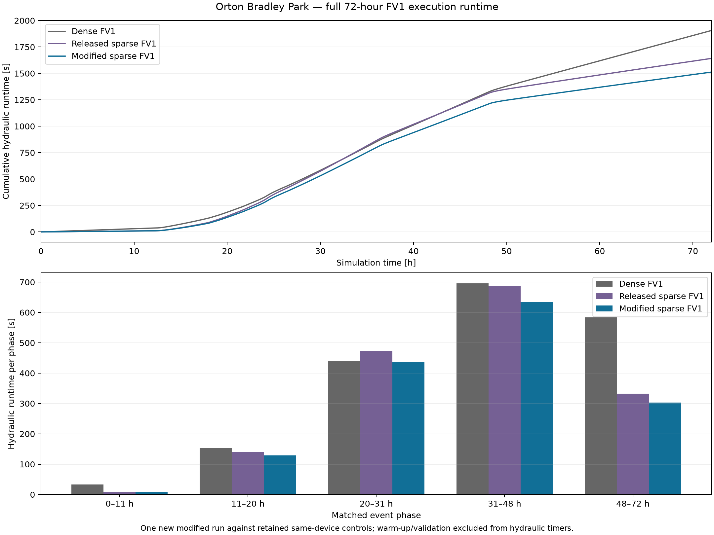
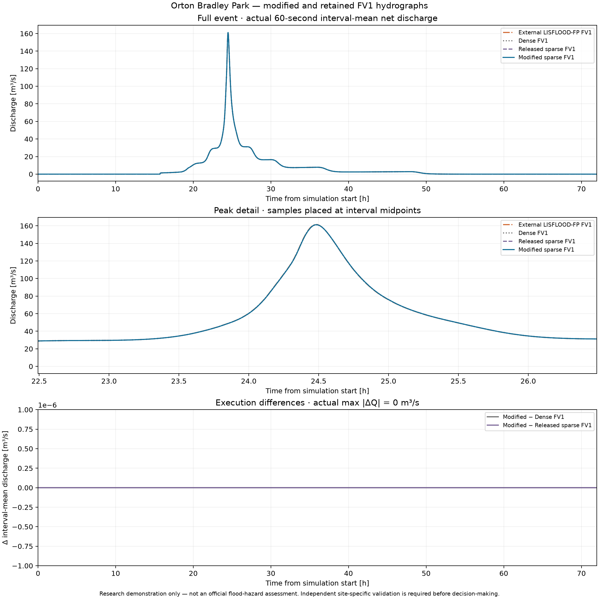

# Modified exact-sparse FV1 — matched 72-hour Orton Bradley event

Completed **72 hours** on the full **1123×843, 5 m** domain with **1,570,053 accepted steps**. All **72 hourly comparisons** against retained dense FV1 have maximum field difference **0**.

| Implementation | Hydraulic [s] | Recorded end-to-end component [s] | Steps |
|---|---:|---:|---:|
| Dense FloodWarp FV1 (retained) | 1906.106 | 2007.819 | 1,570,053 |
| Released sparse FV1 (retained) | 1641.957 | 1742.796 | 1,570,053 |
| Modified sparse FV1 (new) | 1512.372 | 1599.164 | 1,570,053 |
| External LISFLOOD-FP FV1 (retained) | 1403.559 | 1486.865 | 816,514 |

Modified sparse hydraulic runtime is **7.89% lower** than released sparse and **20.66% lower** than retained dense. This is one new candidate event against retained same-device implementations, not interleaved full-event repetitions.

End-to-end columns have different diagnostic workloads: sparse runs include hourly full-state validation and checkpoint hashing; dense/external timers have their original component scopes. The old sparse release-work pause is excluded. Wrapper completion separately records current-process wall time including preflight and live allocator peak; that peak includes the temporary checkpoint-recovery solver and excludes CUDA context/code/reserved memory. Current-process time including preflight: **1602.026 s**; peak additional live pool allocation: **493,016,872 B**. The independent process_time.txt records external wall time and CPU resident-memory peak.

| Event interval [h] | Dense [s] | Released sparse [s] | Modified sparse [s] | Reduction vs released |
|---|---:|---:|---:|---:|
| 0–11 | 33.023 | 9.500 | 9.277 | 2.34% |
| 11–20 | 153.649 | 139.533 | 128.717 | 7.75% |
| 20–31 | 439.989 | 473.205 | 436.813 | 7.69% |
| 31–48 | 695.366 | 687.646 | 634.246 | 7.77% |
| 48–72 | 584.079 | 332.074 | 303.319 | 8.66% |

## Hydraulic verification

Hourly comparisons include depth/momentum, soil/source partition, cumulative rainfall and accepted face volumes, boundary accounting arrays, maximum depth, limiter/pressure/flux scratch and timestep histograms. Final native checkpoint arrays are directly compared to released sparse, including checkpoint controls and forcing arrays. Minute-end evaluated-cell/face/work-tile counts are compared separately; endpoint samples are not per-step integrated work counters.

| Metric | Modified versus dense | Modified versus external FV1 |
|---|---:|---:|
| Final-depth RMSE [m] | 0 | 0.000240504345 |
| Final wet-union RMSE [m] | 0 | 0.00393011668 |
| Maximum-envelope RMSE [m] | 0 | 0.00143480626 |
| Maximum-envelope max absolute difference [m] | 0 | 0.119908348 |
| Hydrograph RMSE [m³/s] | 0 | 0.0452825143 |
| Hydrograph NRMSE / reference peak | 0 | 0.000280416605 |
| Peak discharge error [m³/s] | 0 | -0.310016565 |
| Peak timing error [s] | 0 | 60 |
| Net export difference [m³] | 0 | 12.7501666 |
| Infiltration difference [m³] | 0 | -16.7395771 |
| Maximum-event IoU ≥0.01 m | 1 | 0.998711452 |
| Maximum-event IoU ≥0.1 m | 1 | 0.995776095 |

Final direct checkpoint maximum difference versus released sparse: **0**. Minute-end hydraulic work counts unchanged: **True**. Final water-balance residual: **4.48198989e-09 m³**. Persistent solver allocation: **246,506,124 B**.

Depth-envelope/extent metrics use each cell’s event maximum, not final depth. Hydrographs are actual 60-second interval means from cumulative net export, with separate peak magnitude and timing criteria. Both run settings and original inputs are preserved: FP64, contact HLL, explicit discharge-extrapolated matched stage boundaries, full-domain source/boundary CFL and fine source/soil updates. No shallow water is deleted, and no source/precision/timestep/formulation change is used to obtain performance.

New savings concern redundant scratch clearing and source/activity memory traffic/launches; hydraulic work counts and grid resolution remain unchanged relative to released sparse execution. No sparse-storage or AMR speedup is inferred. Original v0.1.0/v0.1.1 assets and prior benchmark records remain untouched. Source snapshots and lossless minute/hourly records bind this result.

## Reproduce the comparison

`python -m validation.sparse_fv1_modified_assess` checks the completed candidate and retained references, then writes summary.json, the lossless complete record, hydrographs_72h.csv and runtime_72h.csv. `python -m validation.sparse_fv1_modified_figures` regenerates both figures from just the exported tables and summary, without hydraulic execution or access to the original private working directory. Editable paths and display settings are in the execution guards. A new hydraulic replay uses `python -m validation.sparse_fv1_modified_event` with a fresh output directory; completed results are never overwritten. The research driver preserves hourly progress with source/configuration identity checks and verifies native checkpoint continuation separately. This does not change the published standalone replay’s explicit-restart contract.

**Research demonstration only — not an official flood-hazard assessment. Independent site-specific validation is required before decision-making.**
